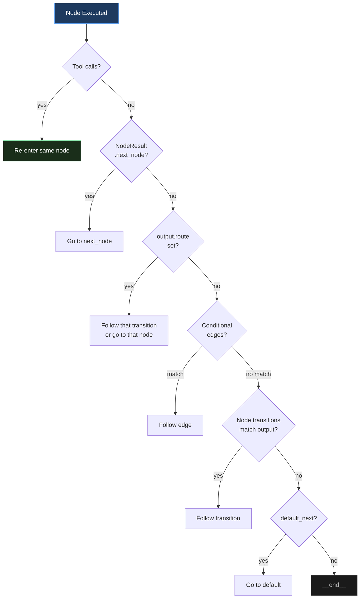

# Graph Edges & Transitions

Edges define how the graph flows from one node to another. The engine resolves transitions dynamically at runtime using a 7-step priority system.

## Edge Dataclass

```python
from promptise.engine import Edge, NodeResult


def my_fn(result: NodeResult) -> bool:
    return result.error is None


Edge(
    from_node="plan",       # Source node name
    to_node="act",          # Target node name
    condition=my_fn,        # Optional: (NodeResult) -> bool
    label="ready",          # Optional: label for visualization
    priority=0,             # Optional: higher = checked first
)
```

## Edge Helpers

All helpers return `self` for chaining: `graph.always("a", "b").always("b", "c")`.

### always: Unconditional

```python
graph.always("plan", "execute")   # plan always goes to execute
```

### when: Conditional

```python
graph.when("review", "fix",
    condition=lambda result: (result.output or {}).get("quality", 0) < 3,
    label="low_quality",
)
```

### on_tool_call / on_no_tool_call: Tool-based routing

```python
graph.on_tool_call("gather", "summarize")   # After a node that made tool calls
graph.on_no_tool_call("gather", "__end__")  # After a node that made none
```

A `PromptNode` whose model called tools is re-entered by the engine before any
edge is checked (step 1 below), so these edges matter for nodes that record
tool calls without asking for that re-entry: a `ToolNode`, a `ParallelNode`, a
`FanOutNode`, a custom node. After a `PromptNode`, `on_no_tool_call` is the
edge that applies once the model answers without tools.

### on_output: Output key matching

```python
graph.on_output("review", "publish", key="approved", value=True)
graph.on_output("review", "revise", key="approved", value=False)
```

### on_error: Error routing

```python
graph.on_error("risky_step", "fallback")   # Route to fallback if node errors
```

### on_confidence: Confidence threshold

```python
graph.on_confidence("analyze", "conclude", min_confidence=0.7)
# Routes to "conclude" when output["confidence"] >= 0.7
```

### on_guard_fail: Guard failure routing

```python
graph.on_guard_fail("validate", "revise")
# Routes to "revise" when any guard fails
```

### sequential: Chain multiple nodes

```python
graph.sequential("step1", "step2", "step3", "step4")
# Creates: step1 → step2 → step3 → step4 (always edges)
```

### loop_until: Conditional loop with exit

```python
graph.loop_until("refine", "deliver",
    condition=lambda result: (result.output or {}).get("quality", 0) >= 4,
    max_iterations=5,
)
# Loops "refine" until quality >= 4, then exits to "deliver"
# Exit edge gets priority=10, loop edge gets priority=0
```

`refine` runs at most `max_iterations` times in a run (fewer if its own `max_iterations` is lower). Once it has used them, the engine exits to `deliver` even though the condition never held. `max_iterations` below 1 raises `ValueError`.

### Low-level add_edge

```python
graph.add_edge("a", "b", condition=my_fn, label="custom", priority=10)
```

### Helper reference

| Helper | Condition | Label |
|--------|-----------|-------|
| `always(a, b)` | none | `""` |
| `when(a, b, condition, label="")` | your `(NodeResult) -> bool` | `label` |
| `on_tool_call(a, b)` | `result.tool_calls` is not empty | `tool_called` |
| `on_no_tool_call(a, b)` | `result.tool_calls` is empty | `no_tools` |
| `on_output(a, b, key, value=True)` | `result.output` is a dict and `output[key] == value` | `key=value` |
| `on_error(a, b)` | `result.error` is set | `error` |
| `on_confidence(a, b, min_confidence=0.7)` | `result.output` is a dict and `float(output.get("confidence", 0)) >= min_confidence` | `confidence>=0.7` |
| `on_guard_fail(a, b)` | `result.guards_failed` is not empty | `guard_failed` |
| `sequential(*names)` | `always` between each pair | |
| `loop_until(node, exit_to, *, condition, max_iterations=5)` | exit edge (priority 10) + self edge (priority 0) + budget | `exit_loop` / `loop` |

All helpers have priority 0 except the `loop_until` exit edge. The built-in
conditions are `EdgeCondition` objects (`EdgeCondition(kind, key="", value=True,
min_confidence=0.0)` with `kind` one of `tool_called`, `no_tool_call`,
`output`, `error`, `confidence`, `guard_failed`), so their edges can be
[saved to YAML](engine-serialization.md); a lambda condition cannot.

`result.error` includes notes hooks write on a successful node (a
`TimingHook` budget overrun, a `BudgetHook` stop), so `on_error` fires on
those too. `result.output` is `None` for a plain-text reply, so `on_output`
and `on_confidence` need a node with an `output_schema` (or a postprocessor
that returns a dict).

A condition that raises is treated as not matching (logged at DEBUG), so
`lambda r: r.output.get("quality") >= 4` silently never fires on a `None`
output. Write `(r.output or {}).get(...)`. Adding a second conditional edge
with the same source, target and priority logs a warning, since the first one
that matches wins.

!!! note "Performance"
    The engine maintains a precomputed adjacency index for **O(1) edge lookup** per transition (instead of scanning all edges). The index is rebuilt lazily when edges are added or removed.

## Transition Resolution

When a node finishes, the engine resolves the next node in this order:



1. **Tool loop**: If tools were called, re-enter the same node so the LLM sees tool results
2. **NodeResult.next_node**: If the node explicitly set the next node in its execute() method (`ValidateNode`'s pass/fail, `PlanNode`'s re-plan)
3. **LLM routing**: If output contains `route`, `_next`, `next_step`, or `goto` naming one of the node's transition keys (follows that transition) or a node in the graph
4. **Graph edges**: Conditional edges checked in priority order (highest first)
5. **Node transitions**: For a dict output, the first `transitions` key whose value in the output is `True`, equals the key, or is any non-empty string
6. **default_next**: Fallback node from the node's configuration
7. **__end__**: Graph terminates

## Edge Priority

When multiple conditional edges exist from the same node, they are checked in **priority order** (highest first). Use this to ensure exit conditions are checked before loop conditions:

```python
# Exit condition checked first (priority 10)
graph.add_edge("refine", "deliver",
    condition=lambda r: (r.output or {}).get("done"),
    label="done", priority=10)

# Loop condition checked second (priority 0)
graph.always("refine", "refine")  # default priority=0
```

## Dynamic LLM Routing

The LLM can choose the next node by including a routing field in its output. Routing reads a structured output, so give the node an `output_schema` (a Pydantic model or a `TypedDict`) with a `route` field:

```python
from typing import Literal

from pydantic import BaseModel


class Decision(BaseModel):
    route: Literal["search", "answer"]
    reason: str


graph.add_node(PromptNode(
    "decide",
    output_schema=Decision,
    transitions={"search": "web_search", "answer": "write"},
))
# The LLM outputs {"route": "search", "reason": "Need more data"}
# → the engine follows the "search" transition to "web_search"

# Supported field names: route, _next, next_step, goto
```

A route value that is a transition key follows that transition; otherwise it must name a node in the graph (or `__end__`). When a node without tools has two or more transitions, the engine lists them in the prompt. The `"error"` transition is reserved: the engine follows it when the node has used its `max_iterations`, and never offers it to the model.

## Runtime Graph Mutation

With `PromptGraphEngine(allow_self_modification=True)` (the default, and what
`build_agent` uses), a node's structured output can carry a `_graph_action`
that changes the run's copy of the graph. The original graph is never
modified, and the engine applies at most `max_mutations_per_run` (default 10)
mutations per run, counting these and the `GraphMutation`s nodes return.

| Action | Output fields | What 1.6.0 does |
|--------|---------------|-----------------|
| `add_node` | `_graph_action: "add_node"`, `_node_config: {...}` | Adds a `PromptNode` built with `PromptNode.from_config(_node_config)`. Nothing routes to it unless an edge, transition or route names it |
| `add_edge` | `_graph_action: "add_edge"`, `_from: "a"`, `_to: "b"` | Adds an unconditional edge |
| `skip_to` | `_graph_action: "skip_to"`, `_target: "node_name"` | Only `_target: "__end__"` takes effect (it ends the run). For another node, the engine's transition resolution runs afterwards and overrides the target; route with a `route` field instead |
| `retry_with` | `_graph_action: "retry_with"`, `_context_update: {...}` | Merges `_context_update` into `state.context`. The node is not re-run by this; the next node is resolved as usual |

The model only produces these fields when its `output_schema` has them, so a
graph whose schemas don't declare `_graph_action` is not affected. To rule it
out, create the engine with `allow_self_modification=False`; `build_agent` has
no switch for it.

A node can also return `GraphMutation`s in `NodeResult.graph_mutations`
(`add_node`, `remove_node`, `add_edge`, `remove_edge`); see
[GraphMutation](engine.md#noderesult-nodeevent-graphmutation-executionreport).
