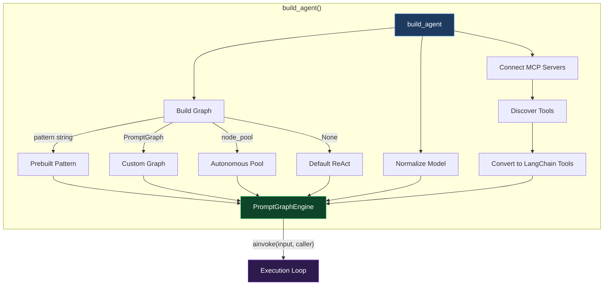
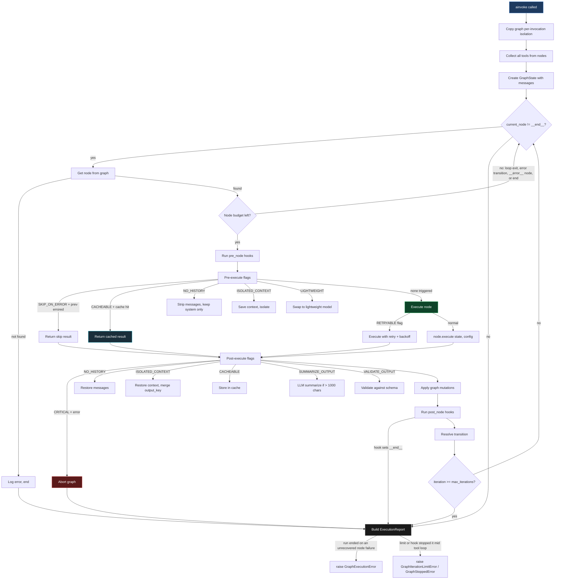
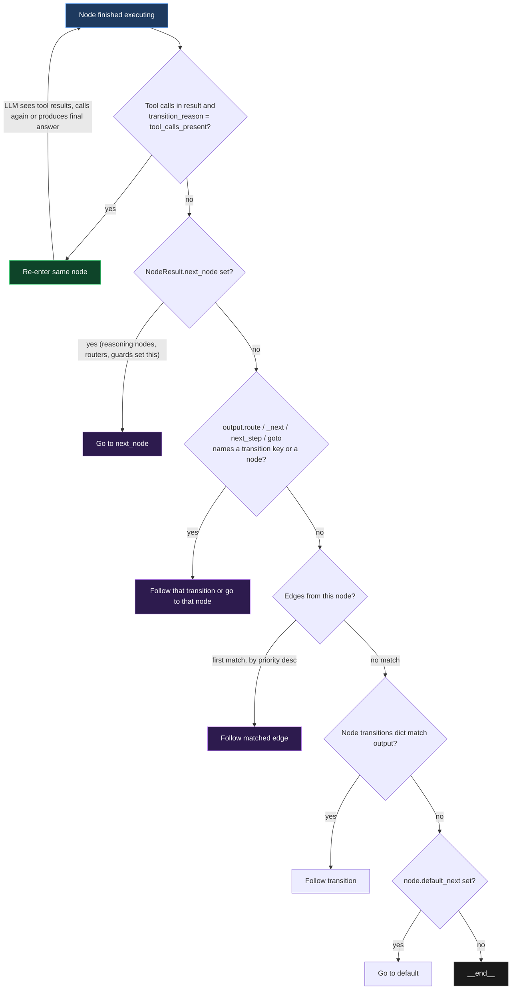
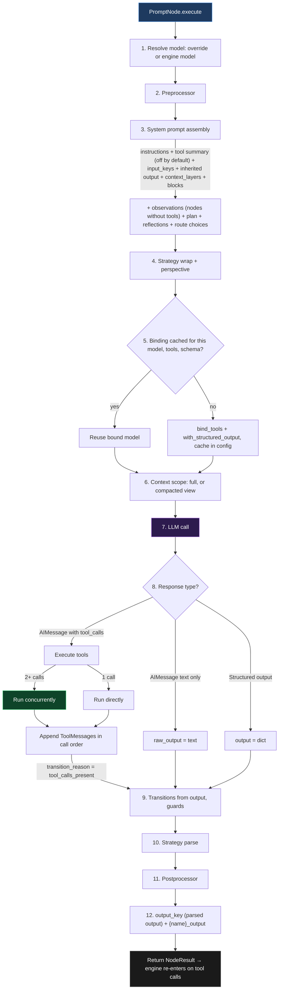
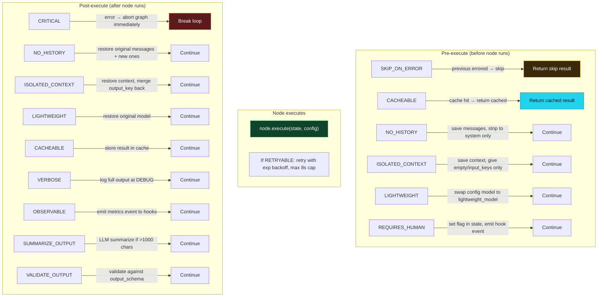
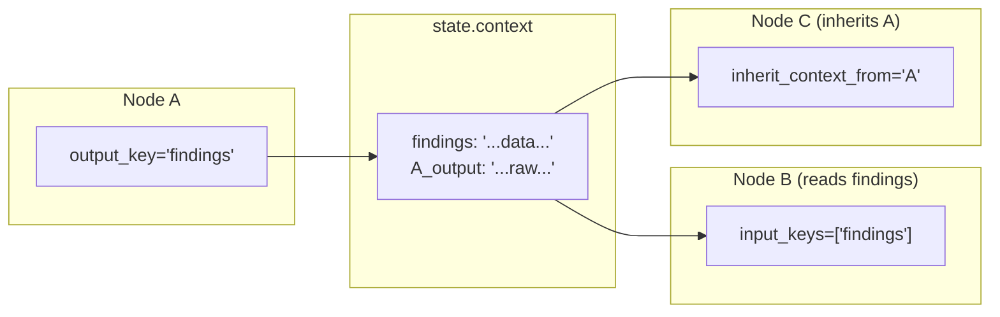
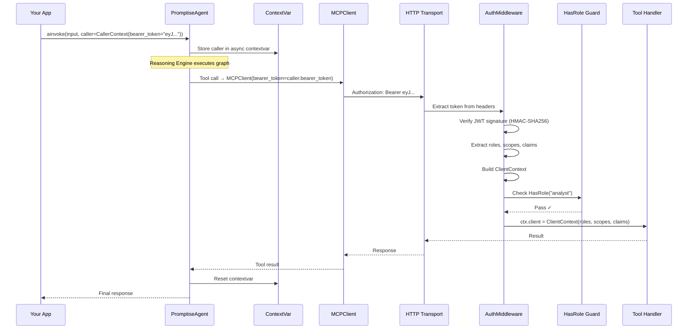
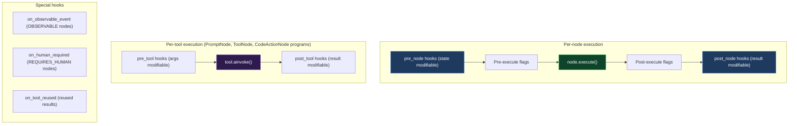

# Reasoning Engine Internals

How the Reasoning Engine works under the hood, execution flow, transition resolution, autonomous path building, caching, flag processing, and the complete data flow from `build_agent()` to tool response.

## The Big Picture

## Execution Loop: What Happens on Every `ainvoke()`

## Transition Resolution: How the Engine Picks the Next Node

After every node executes, the engine decides where to go next. This is the 7-step priority chain:

**Key insight:** Tool-calling nodes re-enter themselves automatically. The LLM calls tools → the node adds ToolMessages to the conversation → the engine re-enters the node → the LLM sees the results → calls more tools or produces a final answer. This loop continues until the LLM stops calling tools or the node's budget (`min(max_iterations, max_node_iterations)`) is used up.

Before a node runs, the engine checks its budget. A node that has used it is
not run again: the engine goes to its `loop_until` exit, else its `"error"`
transition, else an `__error__` node, else ends the run. A run ended that way
in the middle of a tool loop raises `GraphIterationLimitError`.

## Autonomous Mode: How the AI Builds Its Own Path

```mermaid
sequenceDiagram
    participant E as Engine
    participant A as AutonomousNode
    participant LLM as LLM
    participant P as Pool Nodes

    E->>A: execute(state, config)

    loop For each step (up to max_steps)
        A->>LLM: "Here are available nodes:<br/>- plan: Break task into subgoals<br/>- act: Execute tools<br/>- think: Analyze gaps<br/>- reflect: Self-evaluate<br/>- answer: Final synthesis (terminal)<br/><br/>Which should run next?"
        LLM-->>A: {"next_node": "act", "reason": "Need to search for data"}

        alt next_node == "__done__" or terminal node succeeded
            A->>A: Leave the loop
        else Valid node (or a tool of one) selected
            A->>P: Execute chosen node until its tool loop ends
            P-->>A: NodeResult with output
            A->>A: Continue loop
        else Invalid node name
            A->>A: Tell the next routing call, ask LLM again
        end
    end

    opt No terminal node ran last
        A->>P: Run the answer node (first terminal node)
    end
    A-->>E: Return final result
```

In autonomous mode, the `AutonomousNode` wraps the pool and orchestrates:

1. Builds a routing prompt listing all available nodes with descriptions and their tools
2. Asks the LLM which node to run next: the prompt and reply are sent for that call only, never added to `state.messages`
3. Extracts JSON from the response (balanced brace parser for nested objects)
4. Executes the chosen node, re-running it while its model keeps calling tools (a tool name runs the node that has the tool)
5. Loops back to step 2 until the LLM chooses `__done__` or a terminal node succeeds
6. When no terminal node ran last, runs the answer node, so the run ends with a written answer

The developer controls the pool composition, what nodes are available. The LLM controls the path, which nodes to use and in what order.

## PromptNode Execution: The Pipeline

Every execution of a PromptNode is one model call:

## Caching: What Is Reused and When

| Item | Where | Reused while |
|------|-------|--------------|
| Bound model (tools + structured output) | `config["_node_cache_{name}"]` | Same run, same model object (or same `model_override`), same tool names, same `output_schema` |
| Edge adjacency index | `graph._edge_index` | Until an edge is added or removed (lazy dirty flag) |
| Node result (`CACHEABLE` flag) | `state.context["_node_cache"]` | Same run, same `input_keys` values; up to 128 entries |

The system prompt is **not** cached: it is rebuilt on every execution, since
`input_keys`, plan, reflections, observations and the offered tools can change
between steps. The run config is copied per run, so these caches never leak
between runs.

## Flag Processing Order

Flags are processed in two phases around node execution:

## Data Flow Between Nodes

Three ways nodes pass data:

| Method | How it works | Use when |
|--------|-------------|----------|
| `output_key` → `input_keys` | Node A writes its parsed output to `state.context[output_key]` (an `output_schema` dict, a strategy's extracted answer, or a postprocessor's value; nothing for a plain-text reply). Node B gets `state.context[input_keys[i]]` in its prompt. | Structured data with named fields |
| `inherit_context_from` | Node B gets `state.context["{A_name}_output"]` (A's reply text, or its structured output as JSON) in its prompt. Every `PromptNode` writes this key. | One node directly continues another's work, including plain-text replies |
| `state.context` direct | Node's execute() reads/writes `state.context` directly. | Custom state management in BaseNode subclasses |

## CallerContext → MCP Server Identity Flow

## Hook Execution Points

Hooks run in registration order. A failing `pre_node` or `post_node` hook is logged and skipped. A `pre_tool` or `post_tool` hook that raises fails that tool call (the model gets the error). `on_observable_event` and `on_human_required` are not wrapped: an exception there ends the run. The `Hook` protocol's `on_error` and `on_graph_mutation` are not called in 1.6.0.

## Safety Mechanisms

```mermaid
graph TD
    subgraph "Iteration Guards"
        S1["max_iterations (default 50)"] --> |"reached: that many node executions"| S1R["Force graph end"]
        S2["node budget: min(node.max_iterations, max_node_iterations)"] --> |"used up, node not run again"| S2R["_handle_stuck_node()"]
        S2R --> |"error transition exists"| S2A["Follow error edge"]
        S2R --> |"__error__ node exists"| S2B["Go to error handler"]
        S2R --> |"nothing"| S2C["Force __end__"]
    end

    subgraph "Budget & Health"
        S3["BudgetHook.max_tokens"] --> |exceeded| S3R["Set current_node = __end__; GraphBudgetExceededError if no answer"]
        S4["CycleDetectionHook"] --> |"pattern repeats N times"| S4R["Force __end__"]
        S5["TimingHook"] --> |"node exceeds budget"| S5R["Set error on result"]
    end

    subgraph "Error Recovery"
        S6["CRITICAL flag + error"] --> S6R["Abort immediately, report.error set"]
        S7["RETRYABLE flag + error"] --> S7R["Retry up to max_iterations times"]
        S7R --> |"backoff"| S7B["0.5s, 1s, 2s, 4s, 8s (capped)"]
        S8["SKIP_ON_ERROR"] --> S8R["Skip node, continue graph"]
    end

    subgraph "Graph Isolation"
        S9["graph.copy() per invocation"] --> S9R["Mutations don't affect original"]
        S10["config = dict(config)"] --> S10R["Concurrent calls don't interfere"]
        S11["max_mutations_per_run (default 10)"] --> S11R["Cap LLM graph modifications"]
    end

    style S6R fill:#5c1a1a,stroke:#f87171,color:#fff
    style S7B fill:#3a2a0a,stroke:#fbbf24,color:#fff
    style S9R fill:#0e4429,stroke:#4ade80,color:#fff
```

## Performance

The engine's own work per node (copying the graph, looking up edges, flag checks, hooks) is small next to the model and tool calls, which take nearly all of a run's time.
