# Prebuilt Patterns

Ten ready-to-use reasoning patterns. Each factory function returns a configured `PromptGraph`. Use as `agent_pattern` in `build_agent()` or pass directly to `PromptGraphEngine`.

## ReAct (Default)

Single PromptNode with tools. The LLM decides when to call tools and when to answer.

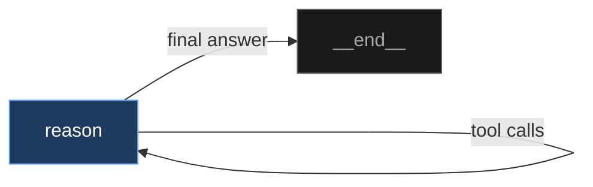

```python
agent = await build_agent(model="openai:gpt-5-mini", servers=my_servers)
# or explicitly:
agent = await build_agent(..., agent_pattern="react")
```

The engine loops: LLM → tools → LLM → tools → ... → final answer.

```python
PromptGraph.react(
    tools=None,              # LangChain BaseTool instances
    system_prompt="",        # System prompt text
    blocks=None,             # PromptBlock objects
    max_node_iterations=15,  # Max tool-calling loops
)
```

## Verify (single-pass self-checking)

A single LLM call in which the model must **plan, solve, and verify its own
answer** before responding. It adds the accuracy benefit of an explicit
self-verification step at **one-turn latency** — no multi-call overhead.

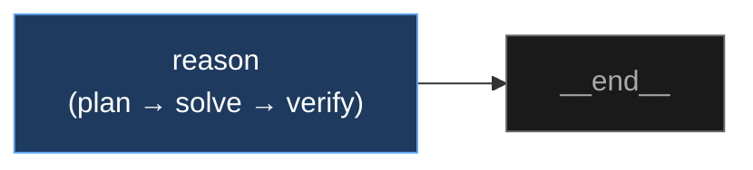

```python
agent = await build_agent(..., agent_pattern="verify")
```

```python
PromptGraph.verify(
    tools=None,
    system_prompt="",
    blocks=None,
    max_node_iterations=6,
)
```

!!! note "When it helps"
    The forced self-check lifts accuracy over a plain direct prompt on **weak
    and mainstream models** at one-turn latency. A *frontier* model that
    already reasons strongly internally is typically at its ceiling with a
    direct prompt, so `verify` there only adds a cheap safety check rather than
    more accuracy. On a capable model it is **comparable to**, not strictly
    better than, a well-prompted ReAct pass. For multi-stage deliberate
    reasoning with per-stage context scoping, compose a custom graph (see
    *Custom Graph*).

## Managed (context-managed tool loop)

For **deep multi-tool tasks** — traversing a database or graph, gathering
many facts then aggregating. A single tool-using node run with
`context_scope="ledger"`: instead of feeding the model an ever-growing
transcript of tool calls and results (where it loses track and re-queries the
same facts), each turn it sees the task, its most recent exchange, and a
compact **deduplicated "facts gathered" ledger**. A call the model does
repeat runs the tool again (its result may have changed); to answer repeats
of lookups whose result cannot change from the earlier result, opt those
tools in with `context_compaction=ContextCompaction(reuse_results=[...])`
(see [Repeated calls run the tool](../guides/context-lifecycle.md#repeated-calls-run-the-tool)).

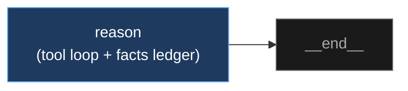

```python
agent = await build_agent(..., agent_pattern="managed")
```

```python
PromptGraph.managed(
    tools=my_tools,
    system_prompt="",
    blocks=None,
    max_node_iterations=30,   # deep tasks make many calls
)
```

The underlying primitive is [`PromptNode(context_scope="ledger")`](engine-nodes.md#context-scope),
which any custom graph can use on a long-running tool node.

!!! note "What it does, honestly"
    The ledger **bounds context** on long tool chains: the request stops
    growing with every tool result. Whether it also cuts tool calls depends
    on the model. Models that re-query facts buried in a long transcript make
    fewer calls with it; others re-read facts the ledger lists. In one audit
    (30 records of about 2,400 characters each), gpt-5-mini made no extra
    calls with compaction, while gpt-4.1-mini on 1.3.3 re-read the same
    records until its token budget ran out (136 calls against 31 without
    compaction). 1.3.4 keeps a result the model fetched again in full and
    stops inviting re-reads of values that "change over time", which removes
    the re-read loop compaction itself caused, but measure your own model
    with `ContextCompaction(enabled=False)` as the baseline. It is an
    **efficiency** primitive: it does not by itself make the model's final
    answer more correct.

## Code-Action (one sandboxed program)

For **aggregation / data-traversal tasks**, the model writes **one Python
program** over your tools in a single LLM turn — instead of chaining dozens of
conversational tool calls. The program runs in Promptise's hardened Docker
sandbox; its tool calls bridge back to the real host tools, so the model gets
code's exactness (loops, sums, filters, joins) while every tool call still
keeps its protections — approval gates if configured, plus budget/health/audit
hooks when the Agent Runtime has attached them — and the node enforces a hard
`max_tool_calls` cap on each program regardless.

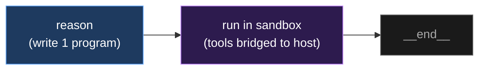

```python
agent = await build_agent(..., agent_pattern="code-action")  # sandbox auto-enabled

# Tune the pattern from build_agent (unknown keys are rejected):
agent = await build_agent(
    ...,
    agent_pattern="code-action",
    code_action={"exec_timeout": 60, "max_repairs": 2, "max_tool_calls": 20},
)
```

```python
PromptGraph.code_action(
    tools=my_tools,
    system_prompt="",
    blocks=None,
    sandbox_factory=...,   # injected by build_agent
    max_repairs=1,         # re-try once on a failed program, feeding the error back
    exec_timeout=120,      # max seconds the program may run
    max_tool_calls=50,     # hard cap on each program's tool calls
)
```

**The tool-call budget.** Every call a program makes counts against
`max_tool_calls`, failed ones included. Once a program reaches it, each further
call raises `ToolBudgetExceeded` in the program without running the tool, a
warning is logged, and the program's output is discarded (it is incomplete,
even if the program caught the error). A repair gets a fresh budget, so a run
makes at most `(max_repairs + 1) × max_tool_calls` calls; with no repair left
the node fails and the run raises `GraphExecutionError`. MCP tool results that
are JSON text reach the program decoded (lists, dicts, numbers), and an MCP
tool error raises in the program. `ExecutionReport.tool_calls` counts the
programs' calls. See [Code-Action](../guides/code-action.md#the-tool-call-budget).

**The mechanism.** In one turn the model writes a program that calls your tools
as ordinary Python functions. Inside the sandbox those functions are RPC stubs:
each writes a request to the workspace; a concurrent host loop runs the *real*
tool and writes back the response. The sandbox has a **read-only rootfs, dropped
capabilities, and no network** — the program's only outside reach is your
bridged tools.

!!! warning "Requirements & honest scope"
    Requires **Docker** (auto-enabled for this pattern). It shines when your
    tools return **structured data** (lists/dicts/numbers) the program can use
    directly, and on tasks a conversational loop gets wrong by re-querying and
    mis-aggregating. It is a *pattern, not a replacement* — for ambiguous or
    conversational tasks prefer `react`/`managed`. Validated end-to-end on a
    real sandbox + real model (see `tests/test_code_action_integration.py`).

## PEOATR

Plan → Act → Think → Reflect → Answer. Structured reasoning with specialized nodes.

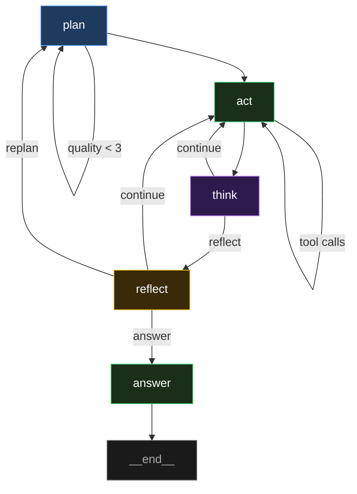

```python
agent = await build_agent(..., agent_pattern="peoatr")
```

```python
PromptGraph.peoatr(
    tools=None,                    # Tools for the act node
    system_prompt="",              # Shared system prompt
    blocks=None,                   # Shared blocks
    planning_instructions="",     # Extra instructions for the plan node
    acting_instructions="",       # Extra instructions for the act node
    thinking_instructions="",     # Extra instructions for the think node
    reflecting_instructions="",   # Extra instructions for the reflect node
    max_act_steps=12,             # Act budget per run (each tool-loop round counts)
)
```

Each stage has its own role:

- **Plan** (PlanNode) — Create subgoals and rate the plan; a plan rated below 3 is redone
- **Act** (PromptNode) — Execute tools for the active subgoal, then summarize what it found
- **Think** (ThinkNode) — Analyze the results: call another tool now (`continue`) or step back (`reflect`)
- **Reflect** (ReflectNode) — Evaluate progress and route: `answer`, `replan` or `continue`
- **Answer** (SynthesizeNode) — Write the final answer from the gathered results

Plan, think and reflect return structured output (`PeoatrPlan`, `PeoatrThought`, `PeoatrReflection` in `promptise.engine.prebuilts`), so their routing decisions always reach the engine. Every stage has an iteration budget (plan 3, act and think `max_act_steps`, reflect 4). A stage that has used its budget hands over to `answer` (`plan` hands over to `act`), so a run always ends with a written answer instead of looping to the engine's step cap.

## Research

Search → Verify → Synthesize. Three-stage research pipeline with optional verification.

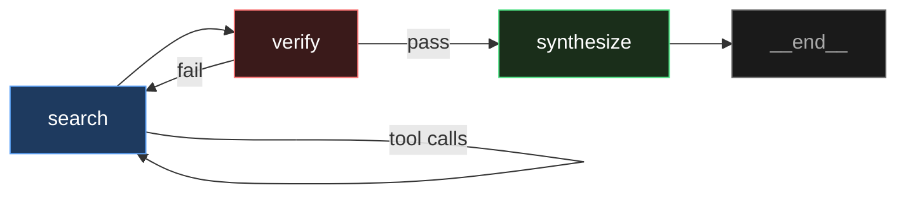

```python
agent = await build_agent(..., agent_pattern="research")
```

```python
PromptGraph.research(
    search_tools=None,       # Tools for the search node
    synthesis_tools=None,    # Tools for the synthesize node (optional)
    system_prompt="",        # Shared system prompt
    blocks=None,             # Shared blocks
    verify=True,             # Include verification step (set False to skip)
    max_search_steps=12,     # Search budget per run (each tool-loop round counts)
    max_verify_rounds=2,     # How many times verify may run
)
```

- **Search** (PromptNode) — Gather information with the tools, then reply with the findings. After a failed check it sees the verifier's issues (`state.context["verification"]`) and looks up what is missing.
- **Verify** (ValidateNode) — A model call that checks the findings against the tool results in the conversation and returns a `ResearchVerdict` (`passes`, `issues`; in `promptise.engine.prebuilts`): every claim backed by a tool result, nothing contradicting the sources or itself, the whole question covered. A failed check routes back to search.
- **Synthesize** (PromptNode) — Write the final answer from the findings.

Verify runs at most `max_verify_rounds` times; once it has, and when search has used its budget, the run moves on to synthesize, so it always ends with a written answer. Each check is one extra model call; pass `verify=False` for search → synthesize without it. For a deterministic check without a model call instead, build the graph yourself with a [`GuardNode`](engine-nodes.md) and your own guards in place of verify.

## Autonomous

Agent receives a pool of configured nodes and dynamically decides which to execute at each step.

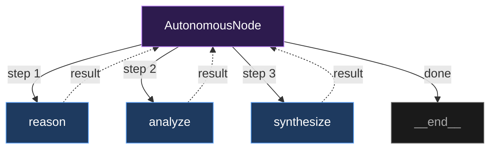

```python
agent = await build_agent(..., agent_pattern="autonomous")
```

```python
PromptGraph.autonomous(
    node_pool=None,          # List of BaseNode instances to choose from
    system_prompt="",        # System prompt for the planner
    tools=None,              # Tools for the default reason node (if no pool provided)
    max_steps=15,            # Maximum autonomous decision steps
    blocks=None,             # PromptBlocks for the default nodes
    max_tool_rounds=10,      # Model calls per reason step in the default pool
)
```

The LLM sees the node catalog (names, descriptions, the tools each step calls, which steps finish the run) and picks the next step, or `__done__`. If no pool is provided, the default pool is `reason` (with the tools), `analyze` and `synthesize`, which writes the final answer and is terminal.

- **A step runs its whole tool loop.** A chosen node is re-run while its model keeps calling tools (up to the node's `max_iterations`), so one step can make several tool calls and read their results before the agent picks again.
- **The routing exchange stays out of the conversation.** The step menu and the model's JSON choice are sent for that one call and never added to the messages, so they can't pile up or become the reply.
- **Tool names map to steps.** A tool name given as the next step runs the pool node that has that tool; an unknown name is reported back to the next routing call.
- **The run ends with an answer.** When the agent finishes (`__done__`, `max_steps`, or an unparseable choice) without a terminal node having run last, the `AutonomousNode`'s `answer_node` runs — by default the first terminal node; with none in the pool, the node asks the model for the final answer itself.
- **Streaming.** `AutonomousNode` streams the chosen steps' model chunks and tool events; the routing calls are not streamed.

## Deliberate

Think → Plan → Act → Observe → Reflect → Answer. Slower, higher-quality reasoning that thinks before acting and observes results carefully.

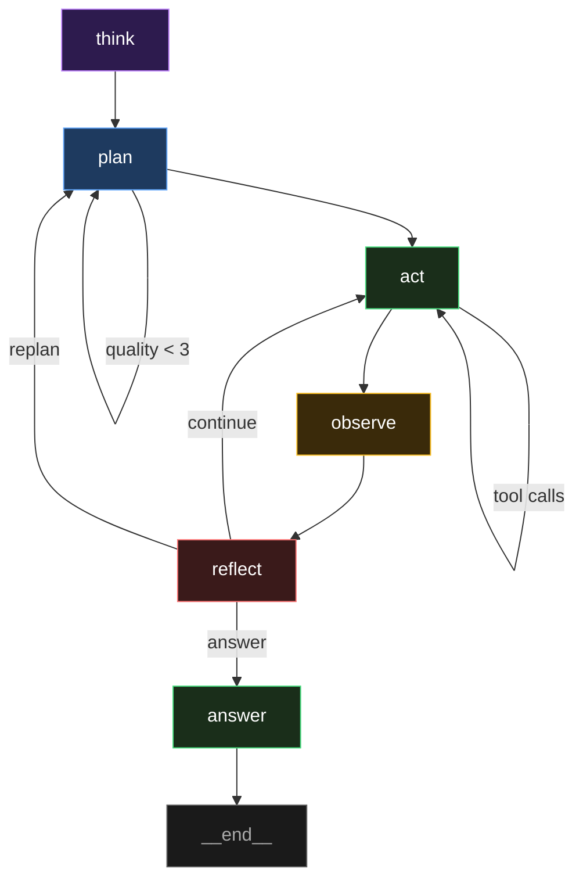

```python
agent = await build_agent(..., agent_pattern="deliberate")
```

```python
PromptGraph.deliberate(
    tools=None,              # Tools for the act node
    system_prompt="",        # Shared system prompt
    blocks=None,             # Shared blocks
    max_act_steps=12,        # Act budget per run (each tool-loop round counts)
)
```

Uses reasoning nodes: ThinkNode → PlanNode → PromptNode (with tools) → ObserveNode → ReflectNode → SynthesizeNode. Plan and reflect return structured output (`PeoatrPlan`, `PeoatrReflection`, as in PEOATR), so the plan's quality gate and reflect's `continue` / `replan` / `answer` route always reach the engine. Every stage has a budget (plan 3, act `max_act_steps`, reflect 4); act and reflect hand over to `answer` when theirs is used, so the run always ends with the `answer` stage's written reply.

## Debate

Adversarial debate. The proposer answers with tools, the critic and the judge send it back until the answer holds up, then `answer` writes the reply.

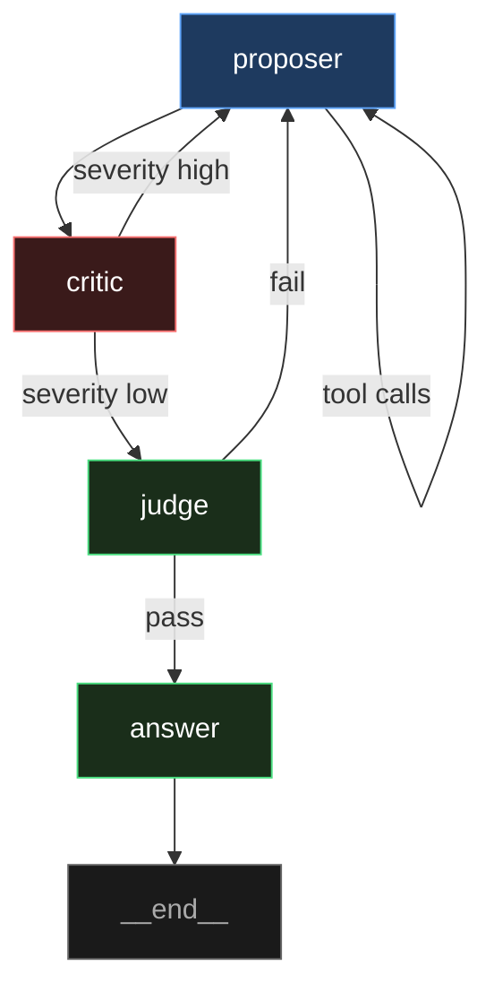

```python
agent = await build_agent(..., agent_pattern="debate")  # the proposer gets the agent's tools
```

```python
PromptGraph.debate(
    system_prompt="",        # Shared system prompt
    tools=None,              # Tools for the proposer
    blocks=None,             # Shared blocks
    max_rounds=3,            # How many times the critic and the judge may each run
    max_proposer_steps=12,   # Proposer budget per run (each tool-loop round counts)
)
```

- **Proposer** (PromptNode) — Answers with the tools. On a revision it sees the latest critique and verdict (`state.context["critique"]`, `state.context["verdict"]`).
- **Critic** (CritiqueNode) — Returns a `DebateCritique` (`weaknesses`, `improvements`, `severity` from 0.0 to 1.0); above 0.3 the answer goes back to the proposer.
- **Judge** (ValidateNode) — Returns a `DebateVerdict` (`passes`, `issues`); a failed verdict goes back to the proposer, a pass goes to `answer`.
- **Answer** (SynthesizeNode) — Writes the final reply: the latest proposal, corrected for any issue still listed.

The schemas are in `promptise.engine.prebuilts`. When the critic has run `max_rounds` times the run goes to the judge; when the judge or the proposer has used its budget, it goes to `answer`, so a debate always ends with a written answer.

## Pipeline

Simple sequential pipeline. Chains provided nodes with always edges. No loops, no conditions.

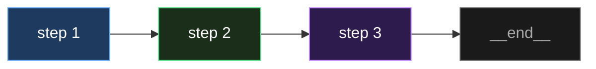

```python
from promptise.engine import PromptGraph, PromptNode

graph = PromptGraph.pipeline(
    PromptNode("extract", instructions="Extract key facts."),
    PromptNode("analyze", instructions="Analyze the facts."),
    PromptNode("format", instructions="Format the results."),
)
agent = await build_agent(..., agent_pattern=graph)
```

```python
PromptGraph.pipeline(
    PromptNode("extract"),   # Variadic: the nodes to chain, in order
    PromptNode("summarize"),
)
```

Automatically sets the first node as entry. The last node defaults to `__end__`.

## Custom Graph

Build any topology. Pass directly to `build_agent()`.

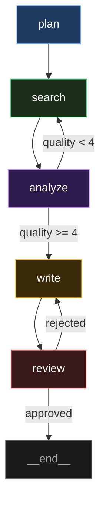

```python
from promptise.engine import PromptGraph, PromptNode, GuardNode
from promptise.engine.skills import planner, web_researcher, summarizer

graph = PromptGraph("custom", mode="static")
graph.add_node(planner("plan"))
graph.add_node(web_researcher("search", tools=search_tools))
graph.add_node(PromptNode("analyze", instructions="Analyze findings.", output_key="analysis"))
graph.add_node(summarizer("write"))
graph.add_node(GuardNode("review", on_pass="__end__", on_fail="write"))

graph.always("plan", "search")
graph.always("search", "analyze")
graph.when("analyze", "write", lambda r: (r.output or {}).get("quality", 0) >= 4)
graph.when("analyze", "search", lambda r: (r.output or {}).get("quality", 0) < 4)
graph.always("write", "review")

graph.set_entry("plan")
agent = await build_agent(..., agent_pattern=graph)
```
