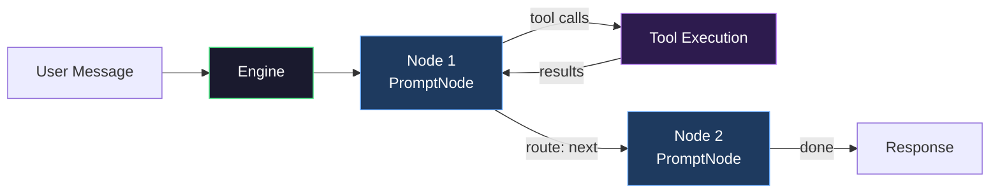
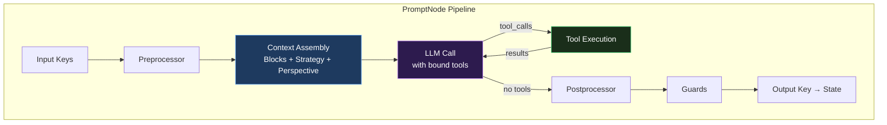

# Reasoning Graph

The Reasoning Graph is Promptise's agent execution engine, a directed graph of composable reasoning nodes where every node is a complete processing pipeline with its own blocks, tools, guards, strategy, context layers, and data flow ports.

## How It Works



Each node is a full pipeline:



## Two Modes

### Autonomous (Default): Agent Builds Its Own Path

Give the agent a pool of nodes. It decides which to run and in what order.

```python
from promptise import build_agent
from promptise.engine import PromptGraph, PromptNode, PlanNode, ThinkNode, ReflectNode, SynthesizeNode

agent = await build_agent(
    model="openai:gpt-5-mini",
    servers=my_servers,
    agent_pattern=PromptGraph("my-agent", nodes=[
        PlanNode("plan", is_entry=True),
        PromptNode("act", inject_tools=True),
        ThinkNode("think"),
        ReflectNode("reflect"),
        SynthesizeNode("answer", is_terminal=True),
    ]),
)
```

Each node is fully pre-configured; the developer just picks the building bricks:

- **PlanNode**: Creates subgoals, self-evaluates quality, re-plans if below threshold
- **ThinkNode**: Analyzes gaps, recommends next step, no tools
- **ReflectNode**: Self-evaluation, identifies mistakes, stores corrections
- **SynthesizeNode**: Combines all findings into final answer
- **PromptNode** with `inject_tools=True`: gets MCP tools at runtime, the only node that calls tools

`build_agent` turns a graph with `mode="autonomous"` (the default), two or more
nodes and no edges into an [`AutonomousNode`](engine-nodes.md#autonomousnode)
over that pool. `PromptGraphEngine` does not: run the same pool directly with
`PromptGraph.from_pool(nodes)`, otherwise the engine just runs the entry node
and follows its transitions.

### Static (Opt-in): Developer Wires Edges

```python
graph = PromptGraph("pipeline", mode="static")
graph.add_node(PlanNode("plan"))
graph.add_node(PromptNode("act", inject_tools=True))
graph.add_node(SynthesizeNode("answer"))
graph.sequential("plan", "act", "answer")
graph.set_entry("plan")

agent = await build_agent(..., agent_pattern=graph)
```

## Quick Start Patterns

```python
# String patterns
agent = await build_agent(..., agent_pattern="react")       # Default tool-calling loop
agent = await build_agent(..., agent_pattern="verify")      # Plan → Solve → Self-check (1 turn)
agent = await build_agent(..., agent_pattern="managed")     # Tool loop with facts-ledger context
agent = await build_agent(..., agent_pattern="code-action") # Writes ONE sandboxed program (1 turn)
agent = await build_agent(..., agent_pattern="peoatr")      # Plan → Act → Think → Reflect → Answer
agent = await build_agent(..., agent_pattern="research")    # Search → Verify → Synthesize
agent = await build_agent(..., agent_pattern="autonomous")  # Agent builds own path
agent = await build_agent(..., agent_pattern="deliberate")  # Think → Plan → Act → Observe → Reflect → Answer
agent = await build_agent(..., agent_pattern="debate")      # Proposer ↔ Critic → Judge → Answer

# Or pass a PromptGraph directly
agent = await build_agent(..., agent_pattern=my_graph)

# Or pass a node pool
agent = await build_agent(..., node_pool=[PlanNode("plan", is_entry=True), ...])
```

## Architecture

```
Reasoning Graph Engine
│
├─ Nodes ─────────────────────────────────────────────────────────
│  │
│  ├─ Standard (11 types)
│  │  ├─ Core
│  │  │  ├── PromptNode              LLM reasoning with full pipeline
│  │  │  ├── ToolNode                Explicit tool execution
│  │  │  ├── TransformNode           Pure data transformation (no LLM)
│  │  │  └── CodeActionNode          One sandboxed program over the tools
│  │  │
│  │  ├─ Flow Control
│  │  │  ├── RouterNode              LLM-based dynamic routing
│  │  │  ├── GuardNode               Validate and gate with pass/fail
│  │  │  ├── LoopNode                Repeat until condition met
│  │  │  └── HumanNode              Pause for human approval
│  │  │
│  │  └─ Composition
│  │     ├── ParallelNode            Run children concurrently
│  │     ├── SubgraphNode            Embed a complete sub-graph
│  │     └── AutonomousNode          Agent picks from node pool
│  │
│  ├─ Reasoning (10 pre-built)
│  │  ├─ Analysis
│  │  │  ├── ThinkNode               Gap analysis, confidence scoring
│  │  │  ├── ObserveNode             Tool result interpretation
│  │  │  └── CritiqueNode            Adversarial self-review
│  │  │
│  │  ├─ Planning & Reflection
│  │  │  ├── PlanNode                Structured planning with subgoals
│  │  │  ├── ReflectNode             Self-evaluation, mistake correction
│  │  │  └── JustifyNode             Audit trail justification
│  │  │
│  │  ├─ Output
│  │  │  ├── SynthesizeNode          Final answer composition
│  │  │  └── ValidateNode            LLM-powered quality validation
│  │  │
│  │  └─ Orchestration
│  │     ├── RetryNode               Retry wrapper with backoff
│  │     └── FanOutNode              Parallel sub-questions
│  │
│  └─ Custom
│     ├── @node decorator             Any async function → node
│     └── BaseNode subclass           Full custom behavior
│
├─ Edges & Transitions ──────────────────────────────────────────
│  │
│  ├─ Unconditional
│  │  ├── always()                    A always goes to B
│  │  └── sequential()               Chain A → B → C → ...
│  │
│  ├─ Conditional
│  │  ├── when()                      Custom predicate
│  │  ├── on_tool_call()              When tools were called
│  │  ├── on_no_tool_call()           When no tools (final answer)
│  │  ├── on_output()                 When output key matches value
│  │  ├── on_error()                  When node errors
│  │  ├── on_confidence()             When confidence >= threshold
│  │  └── on_guard_fail()             When any guard fails
│  │
│  ├─ Loop
│  │  └── loop_until()                Repeat until condition, then exit
│  │
│  └─ Dynamic (LLM-directed)
│     └── output.route                LLM names next node at runtime
│
├─ Flags (18 typed) ─────────────────────────────────────────────
│  │
│  ├─ Execution Control
│  │  ├── ENTRY / TERMINAL            Graph start and end markers
│  │  ├── CRITICAL                    Abort graph on error
│  │  ├── SKIP_ON_ERROR               Skip if previous node errored
│  │  ├── RETRYABLE                   Retry with exponential backoff
│  │  └── REQUIRES_HUMAN              Flag for human input
│  │
│  ├─ Context & Memory
│  │  ├── NO_HISTORY                  Strip conversation messages
│  │  ├── ISOLATED_CONTEXT            Clean context, merge back output only
│  │  └── CACHEABLE                   Cache result by input keys
│  │
│  ├─ Model Selection
│  │  ├── INJECT_TOOLS                Receive MCP tools at runtime
│  │  └── LIGHTWEIGHT                 Use smaller model for this node
│  │
│  ├─ Observability
│  │  ├── OBSERVABLE                  Emit detailed metrics to hooks
│  │  └── VERBOSE                     Full output in logs
│  │
│  ├─ Output Processing
│  │  ├── SUMMARIZE_OUTPUT            LLM-summarize long outputs
│  │  └── VALIDATE_OUTPUT             Validate against output_schema
│  │
│  └─ Concurrency & State
│     ├── READONLY / STATEFUL         Read-only vs state-modifying
│     └── PARALLEL_SAFE               Safe for concurrent execution
│
├─ Pipeline Processing ──────────────────────────────────────────
│  │
│  ├─ Preprocessors (before LLM call)
│  │  ├── context_enricher            Add timestamp, iteration info
│  │  ├── state_summarizer            Truncate long context values
│  │  └── input_validator             Require context keys
│  │
│  ├─ Postprocessors (after LLM call)
│  │  ├── json_extractor              Parse JSON from LLM output
│  │  ├── confidence_scorer           Score hedging language
│  │  ├── state_writer                Write output fields to context
│  │  └── output_truncator            Cap output length
│  │
│  └─ Combinators
│     ├── chain_preprocessors()       Compose N preprocessors
│     └── chain_postprocessors()      Pipe output through N functions
│
├─ Hooks & Observability ────────────────────────────────────────
│  │
│  ├─ Logging & Debugging
│  │  ├── LoggingHook                 Per-node execution logs
│  │  └── CycleDetectionHook          Detect and break infinite loops
│  │
│  ├─ Performance
│  │  ├── TimingHook                  Per-node time budgets
│  │  └── MetricsHook                 Collect calls, tokens, latency
│  │
│  ├─ Cost Control
│  │  └── BudgetHook                  Token and USD budget enforcement
│  │
│  └─ Reporting
│     ├── ExecutionReport             Per-run summary (iterations, tokens, path)
│     └── NodeResult                  Per-node trace (27 fields)
│
├─ Prebuilt Patterns (10) ───────────────────────────────────────
│  │
│  ├─ Simple
│  │  ├── react                       Single node with tools (default)
│  │  └── pipeline                    Sequential chain
│  │
│  ├─ Context-Managed (single node)
│  │  ├── verify                      Plan → Solve → Self-check (1 turn)
│  │  ├── managed                     Tool loop with deduplicated facts ledger
│  │  └── code-action                 Writes ONE sandboxed program (1 turn)
│  │
│  ├─ Structured Reasoning
│  │  ├── peoatr                      Plan → Act → Think → Reflect → Answer
│  │  ├── deliberate                  Think → Plan → Act → Observe → Reflect → Answer
│  │  └── research                    Search → Verify → Synthesize
│  │
│  └─ Advanced
│     ├── autonomous                  Agent builds own path from pool
│     └── debate                      Proposer ↔ Critic → Judge → Answer
│
├─ Skills Library (15 factories) ─────────────────────────────────
│  │
│  ├─ Standard Skills
│  │  ├── web_researcher              Search + cite sources
│  │  ├── code_reviewer               Security, performance, best practices
│  │  ├── data_analyst                Evidence-based, quantified claims
│  │  ├── fact_checker                Verification guard
│  │  ├── summarizer                  Concise synthesis
│  │  ├── planner                     Step-by-step planning
│  │  ├── decision_router             LLM-based routing
│  │  └── formatter                   Data transformation
│  │
│  └─ Reasoning Skills
│     ├── thinker                     ThinkNode factory
│     ├── reflector                   ReflectNode factory
│     ├── critic                      CritiqueNode factory
│     ├── justifier                   JustifyNode factory
│     ├── synthesizer                 SynthesizeNode factory
│     ├── validator_node              ValidateNode factory
│     └── observer_node               ObserveNode factory
│
└─ Serialization ─────────────────────────────────────────────────
   ├── save_graph() / load_graph()    YAML file persistence
   ├── graph_to_config()              Graph → dict
   ├── graph_from_config()            Dict → graph
   └── register_node_type()           Custom types for YAML
```

## Streaming runs the same steps

`PromptGraphEngine` has three entry points, and all three drive one traversal
loop: the same hooks, flags, mutations and transitions, one model call per
step, tool calls in parallel.

| Method | Yields |
|---|---|
| `ainvoke(input)` | Nothing, returns `{"messages": [...]}` at the end |
| `astream(input)` | `{"messages": [...]}` after every node; the last chunk equals `ainvoke()`'s result |
| `astream_events(input)` | Events: `on_chat_model_stream` per model chunk, `on_tool_start` / `on_tool_end` / `on_tool_error` per tool call (a start and its end share a `run_id`), `on_node_start` / `on_node_end` / `on_node_error` |

When streaming, the engine runs each node through `node.stream()`.
`PromptNode.stream()` streams its one model call and runs the same pipeline as
`execute()`; other nodes execute once and report their result. A node's stream
must end with an `on_node_end` event carrying its `NodeResult` under
`data["result"]`: a stream that ends without one fails the run rather than
running the node a second time. `PromptGraphEngine.astream_events()` is what
[`agent.astream_with_tools()`](streaming.md) consumes.

## Failures reach the caller

A run that ends on a node whose own execution failed (a rejected API key, a
provider outage, a `CRITICAL` node error, a `RETRYABLE` node out of retries)
raises `GraphExecutionError` from `ainvoke()` (and from `astream()` and
`astream_events()` after their output). The exception names the graph and node, carries the
`ExecutionReport`, and chains the provider exception as `__cause__`;
`PromptiseAgent.ainvoke()` lets it propagate. A failure the graph *recovers*
from does not raise: an edge routes it to a handler node that succeeds, or a
hook sets `error_recovered` / clears the node's `error`. Hooks that annotate a
successful node's `error` (timing, budget) do not count as failures. What
never happens: an "answer" that silently echoes the question because the
model call failed.

```python
from promptise.engine import GraphExecutionError

try:
    result = await agent.ainvoke({"messages": [{"role": "user", "content": "Hi"}]})
except GraphExecutionError as exc:
    print(exc.node_name, exc.__cause__)   # 'reason' AuthenticationError(...)
```

An iteration limit that stops a run in the middle of a tool loop (the model
asked for tools and the limit ended the run before it saw their results)
raises `GraphIterationLimitError`, a `GraphExecutionError` with `limit` and
`pending_tools` (the tools whose results the model never saw, including calls
a `ToolNode(tool_selector=...)` made without a model turn). The limit is
the node's budget (`PromptNode(max_iterations=...)`, capped by the engine's
`max_node_iterations` when one is set; `max_agent_iterations` on the `reason`
node of `build_agent`'s ReAct and `managed` graphs, 15 for `PromptGraph.react()`
on its own) or the engine's
`max_iterations` for the whole run (`build_agent(max_agent_iterations=...)`).
The last message of such a run is a tool result, not an answer, so it is never
returned as one. A limit reached after the model answered, or one that routes
to an `"error"` transition or `__error__` node, ends the run as before.

Both limits count node executions, and a limit of N allows exactly N. In the
ReAct graph `build_agent` uses by default, one execution of `reason` is one
model call plus the tool calls that call asked for, so
`max_agent_iterations=N` allows at most N model calls (`build_agent` gives the
reason node the same budget). If the Nth model call asks for
tools, they run, the run stops before the model sees their results, and it
raises `GraphIterationLimitError`. In a graph with separate nodes (a `ToolNode`,
a planner, a reflection step) every node execution counts.

A hook that ends a run in the middle of a tool loop raises
`GraphStoppedError` for the same reason (`GraphBudgetExceededError` when it is
a [`BudgetHook`](engine-hooks.md#budgethook) that the run went over).

```python
from promptise.engine import GraphIterationLimitError

try:
    result = await agent.ainvoke({"messages": [{"role": "user", "content": "Wait for job 42"}]})
except GraphIterationLimitError as exc:
    print(exc.node_name, exc.limit, exc.pending_tools)   # 'reason' 15 ['queue_status']
```

## Run a graph without an agent

`build_agent()` wraps the engine for you. To run a graph on its own (tests, a
batch job, a graph inside your own service), create a `PromptGraphEngine`:

```python
from promptise import resolve_model, tool
from promptise.engine import PromptGraph, PromptGraphEngine


@tool
def add(a: int, b: int) -> int:
    """Add two integers."""
    return a + b


graph = PromptGraph.react(tools=[add], system_prompt="Use the tools for arithmetic.")
engine = PromptGraphEngine(graph, resolve_model("openai:gpt-5-mini"))

result = await engine.ainvoke({"messages": [{"role": "user", "content": "What is 17 + 25?"}]})
print(result["messages"][-1].content)   # 42 (wording varies by model)
print(engine.last_report.summary())     # iterations, tokens, path, tool calls
```

Input messages can be dicts (`{"role": "user", "content": ...}`), `(role, text)`
tuples or LangChain message objects; dicts and tuples are converted when the run
starts. The result's messages are LangChain message objects.

### PromptGraphEngine

`PromptGraphEngine(graph, model, *, ...)`:

| Parameter | Type | Default | Description |
|-----------|------|---------|-------------|
| `graph` | `PromptGraph` | *required* | The graph to run. Every run works on `graph.copy()`, so runtime mutations never change it and concurrent runs do not interfere |
| `model` | chat model | *required* | The model nodes call when they set no `model_override`. `build_agent` passes the model it resolved; standalone, use `resolve_model("openai:gpt-5-mini")` |
| `max_iterations` | `int` | `50` | Node executions per run; `N` allows exactly `N`. `build_agent` sets it from `max_agent_iterations` (default 25) |
| `max_node_iterations` | `int \| None` | `None` | Optional ceiling on how often one node runs in a run (each tool-loop round counts). `None` leaves each node's own `max_iterations` in charge; with a value the lower of the two applies. `build_agent` sets none. Before 1.7.0 the default was 25, which capped `PromptGraph.managed()`'s 30 |
| `hooks` | `list` | `None` | [Hooks](engine-hooks.md), called in list order |
| `allow_self_modification` | `bool` | `True` | Follow `_graph_action` fields in a node's structured output (see [Runtime graph mutation](engine-edges.md#runtime-graph-mutation)). `False` ignores them; `GraphMutation`s a node returns in `NodeResult.graph_mutations` are applied either way |
| `max_mutations_per_run` | `int` | `10` | Cap on mutations per run (both kinds); later ones are dropped with a warning |
| `lightweight_model` | chat model | `None` | Model for nodes with the `LIGHTWEIGHT` flag and no `model_override`. `build_agent` sets none, so the flag has no effect in agents |
| `tools` | `list` | `None` | Tools for nodes with `inject_tools=True`; tools declared on the graph's nodes are added to them |
| `compaction` | `ContextCompaction` | `None` | [Compaction settings](../guides/context-lifecycle.md#tune-it-or-turn-it-off) for compacting nodes that set none of their own |
| `tool_summary` | `str \| None` | `None` | `"off"`, `"names"` or `"full"`: the "Available tools" block of `PromptNode`s that set no `tool_summary`. `None` means `"off"`; any other value raises `ValueError` |
| `human_handler` | `async (prompt, state) -> bool` | `None` | The handler [`HumanNode`](engine-nodes.md#humannode) steps ask, unless the run's config has a `_human_handler`. Without one a `HumanNode` fails. `build_agent(approval=...)` sets it |

| Member | Description |
|--------|-------------|
| `await ainvoke(input, config=None)` | Run to the end; returns `{"messages": [...]}` |
| `astream(input, config=None)` | Async iterator of `{"messages": [...]}` after every node |
| `astream_events(input, *, config=None, version="v2")` | Async iterator of event dicts (see [Streaming](#streaming-runs-the-same-steps)) |
| `last_report` | The `ExecutionReport` of the latest run (also after a stream or a raised error) |

`config` is the LangChain run config (callbacks, tags, metadata). Keys starting
with `_` are the engine's own: `_human_handler` sets the [`HumanNode`](engine-nodes.md#humannode)
handler for one run (it wins over `human_handler=`), the others are set by the
engine and by `build_agent`.

### PromptGraph

`PromptGraph(name="graph", *, mode="autonomous", nodes=None)`. Passing `nodes`
adds them and makes the first node with `is_entry=True` the entry (adding a
node later with `add_node()` does not set the entry; call `set_entry()`).
`mode` is `"autonomous"` or `"static"`; it only changes what `build_agent` does
with an edgeless graph (see [Two Modes](#two-modes)).

| Method | Returns | Description |
|--------|---------|-------------|
| `add_node(node)` | `self` | Add a node; a node with the same name replaces the old one (with a warning) |
| `remove_node(name)` | `self` | Remove a node, its edges, its `loop_until` budget, and the entry if it was the entry |
| `get_node(name)` | node | Raises `KeyError` listing the available names |
| `has_node(name)` | `bool` | |
| `nodes` | `dict` | Copy of the name → node mapping |
| `set_entry(name)` / `entry` | `self` / `str \| None` | Set (raises `KeyError` for an unknown node) and read the entry node |
| `add_edge(from_node, to_node, *, condition=None, label="", priority=0)` | `self` | See [Edges](engine-edges.md); unknown node names only log a warning, since nodes may be added later |
| `always`, `when`, `on_tool_call`, `on_no_tool_call`, `on_output`, `on_error`, `on_confidence`, `on_guard_fail`, `sequential`, `loop_until` | `self` | [Edge helpers](engine-edges.md#edge-helpers) |
| `get_edges_from(name)` / `edges` | `list[Edge]` | Outgoing edges sorted by priority (highest first) / all edges |
| `loop_limit(name)` | `(max_iterations, exit_to) \| None` | The budget `loop_until()` set for a node |
| `validate()` | `list[str]` | Problems found: no or unknown entry, edges or transitions to unknown nodes, nodes unreachable from the entry. Empty means valid. The engine does not call it; call it in tests |
| `describe()` | `str` | One line per node with its type and targets |
| `to_mermaid()` | `str` | The graph as a Mermaid `graph TD` diagram |
| `copy()` | `PromptGraph` | Copy for one run: nodes are shared, edges are copied on first change |
| `apply_mutation(mutation)` | `None` | Apply a `GraphMutation` (what the engine does with runtime mutations) |
| `PromptGraph.from_pool(nodes, *, system_prompt="", name="autonomous")` | `PromptGraph` | One `AutonomousNode("orchestrator")` over the pool |
| `PromptGraph.react(...)`, `.managed(...)`, `.code_action(...)`, `.verify(...)`, `.peoatr(...)`, `.research(...)`, `.autonomous(...)`, `.deliberate(...)`, `.debate(...)`, `.pipeline(*nodes)` | `PromptGraph` | [Prebuilt patterns](engine-prebuilts.md) |

```python
from promptise.engine import PromptGraph, PromptNode

graph = PromptGraph("checked", mode="static")
graph.add_node(PromptNode("draft", instructions="Draft an answer."))
graph.add_node(PromptNode("polish", instructions="Polish the draft.", default_next="__end__"))
graph.always("draft", "polish")
graph.set_entry("draft")

assert graph.validate() == []
print(graph.describe())
# PromptGraph "checked"
# ├── [entry] draft (PromptNode) → polish
# ├── polish (PromptNode) → __end__
print(graph.to_mermaid())
```

## State, results and events

### GraphState

Every node gets the run's `GraphState`. It is created per run from the input
messages and passed to hooks.

| Field | Type | Default | Description |
|-------|------|---------|-------------|
| `messages` | `list` | `[]` | The conversation; nodes append to it |
| `context` | `dict` | `{}` | Key-value data shared by the nodes (`output_key`, `input_keys`, `{name}_output`) |
| `current_node` | `str` | `""` | The node being run; a hook that sets it to `"__end__"` ends the run |
| `visited` | `list[str]` | `[]` | Node names in the order they ran |
| `iteration` | `int` | `0` | Node executions so far in the run |
| `node_iterations` | `dict[str, int]` | `{}` | Executions per node, checked against the node budget |
| `max_messages` | `int` | `200` | After each node, `messages` is trimmed to this many: system messages and the current question are kept, then the most recent messages (`0` disables trimming) |
| `graph` | `PromptGraph` | `None` | The run's live copy of the graph |
| `plan` | `list[str]` | `[]` | Subgoals (set by a `PlanNode` from its `subgoals` field) |
| `completed` | `list[str]` | `[]` | Completed subgoals (`complete_subgoal()`) |
| `observations` | `list[dict]` | `[]` | One `{tool, result, args, success, duration_ms}` per tool call; the last 50 are kept |
| `reflections` | `list[dict]` | `[]` | `{iteration, mistake, correction, confidence, stage}`; the last 5 are kept |
| `tool_calls_made` | `int` | `0` | Tool calls recorded through `add_observation()`; becomes `ExecutionReport.tool_calls` |
| `node_timings` | `dict[str, float]` | `{}` | Total milliseconds per node |
| `total_tokens` | `int` | `0` | Tokens so far in the run |
| `node_history` | `list[NodeResult]` | `[]` | Every node's result, in order |
| `turn_question` | message | `None` | The current question: the last user message of the input |
| `turn_input` | `list` | `[]` | The input up to and including `turn_question` (system messages and chat history) |

Helpers: `add_observation(tool_name, result, args=None, success=True, duration_ms=0.0)`,
`add_reflection(iteration, mistake, correction, confidence=0.5, stage="")`,
`complete_subgoal(subgoal)`, the `active_subgoal` and `all_subgoals_complete`
properties, `record_node_timing(name, ms)`, `increment_node_iteration(name)` and
`trim_messages()`.

### NodeResult, NodeEvent, GraphMutation, ExecutionReport

- [`NodeResult`](engine-hooks.md#noderesult) is what one node execution produced (27 fields: timing, tokens, tool calls, output, routing, guards, error).
- [`ExecutionReport`](engine-hooks.md#executionreport) summarizes a run (`engine.last_report`, `exc.report`).
- `NodeEvent(event, node_name="", data={}, timestamp=time.monotonic())` is what a node's `stream()` yields. Built-in nodes yield `on_node_start`, `on_chat_model_stream` (`data["chunk"]`, `data["run_id"]`), `on_tool_start` / `on_tool_end` / `on_tool_error` and a final `on_node_end` with `data["result"]` (the `NodeResult`). The engine also passes an `on_node_metrics` `NodeEvent` to hooks' `on_observable_event()` for `OBSERVABLE` nodes.
- `GraphMutation` is a change a node asks for in `NodeResult.graph_mutations`:

| Field | Type | Default | Description |
|-------|------|---------|-------------|
| `action` | `str` | *required* | `"add_node"`, `"remove_node"`, `"add_edge"` or `"remove_edge"`; anything else is logged and ignored |
| `node_name` | `str` | `""` | Node to add (defaults to the config's `name`) or remove |
| `node_config` | `dict` | `{}` | For `add_node`: `PromptNode.from_config()` settings (`name`, `instructions`, `transitions`, `default_next`, ...). Only `PromptNode`s can be added this way |
| `from_node` | `str` | `""` | Edge source (`add_edge`, `remove_edge`) |
| `to_node` | `str` | `""` | Edge target |
| `condition` | `str` | `""` | Used as the new edge's **label**; an added edge is always unconditional |

```python
from promptise.engine import GraphMutation, NodeResult, node


@node("triage", default_next="__end__")
async def triage(state):
    # Add a review step to this run's graph, and route to it.
    return NodeResult(
        node_name="triage",
        next_node="review",
        graph_mutations=[GraphMutation(
            action="add_node",
            node_config={"name": "review", "instructions": "Review the answer.",
                         "default_next": "__end__"},
        )],
    )
```

## Exceptions

All are in `promptise.engine` and carry the run's `ExecutionReport` as `report`.

| Exception | Raised when | Extra attributes |
|-----------|-------------|------------------|
| `GraphExecutionError` (a `RuntimeError`) | The run ended on a node failure nothing recovered from | `graph_name`, `node_name`, `error`, `report`; the provider exception as `__cause__` |
| `GraphIterationLimitError` | A node budget or `max_iterations` stopped the run between a tool call and the model's next step | `limit`, `pending_tools` |
| `GraphStoppedError` | A hook ended the run (`state.current_node = "__end__"`) between a tool call and the model's next step | `reason`, `stopped_by` (hook class name), `pending_tools` |
| `GraphBudgetExceededError` | A `GraphStoppedError` caused by a `BudgetHook` | as `GraphStoppedError` |
| `CodeActionBudgetError` | A code-action run could not do the job within `max_tool_calls` | `max_tool_calls`, `attempts` |

All of them subclass `GraphExecutionError`, so one `except GraphExecutionError`
catches every engine failure.

A graph without an entry node raises `ValueError` before anything runs; a
transition to a node name that is not in the graph logs an error and ends the
run.

## What the engine does for you

- **Edge lookup by index**: outgoing edges are kept in a precomputed, priority-sorted index, rebuilt when edges change.
- **Parallel tool calls**: two or more tool calls in one model reply run concurrently; their results are appended in the order the model asked for them.
- **Binding reuse**: a `PromptNode` reuses its tool binding (`bind_tools()` and structured output) when it runs again in the same run with the same model and tools. The system prompt is rebuilt on every execution, since its inputs change.
- **Full tool results by default**: a `PromptNode` passes tool results through as they are. They are cut only where you ask: `ToolNode(max_result_chars=4000)`, and the ledger excerpt of [context compaction](../guides/context-lifecycle.md) (`keep_result_chars`, 2,000).
- **Bounded state**: observations (last 50), reflections (last 5) and messages (`max_messages`, 200) are capped per run.

## Runtime Tool Injection

Nodes with `inject_tools=True` receive the agent's tools at runtime (see [Runtime Tool Injection](engine-tools.md)):

```python
from promptise.engine import PromptNode, ThinkNode

PromptNode("search", inject_tools=True)  # Gets all MCP tools at runtime
ThinkNode("think")                        # No tools (pre-configured)
```

## Dynamic LLM Routing

A node routes dynamically when its output is a dict with a `route`, `_next`,
`next_step` or `goto` field naming one of its transition keys or a node. Give
the node an `output_schema` with that field (a `ReflectNode` also reads `route`
from the JSON object at the end of a text reply); see
[Dynamic LLM Routing](engine-edges.md#dynamic-llm-routing).

## Runtime Graph Mutation

A node can change the run's copy of the graph: by returning `GraphMutation`s
(above), or, when `allow_self_modification=True` (the default), through
`_graph_action` fields in its structured output. See
[Runtime Graph Mutation](engine-edges.md#runtime-graph-mutation) for what each
action does and its limits.

## Next Steps

- [Nodes](engine-nodes.md): All 21 node types with full parameter reference
- [Edges & Transitions](engine-edges.md): 10 edge helpers, transition resolution, LLM routing
- [Node Flags](engine-flags.md): 18 typed flags controlling execution, caching, error handling
- [Processors](engine-processors.md): Pre/post processors for data transformation
- [Runtime Tool Injection](engine-tools.md): How MCP tools flow into nodes
- [Hooks & Observability](engine-hooks.md): 5 hooks, execution reports, per-node metrics
- [Prebuilt Patterns](engine-prebuilts.md): 10 ready-to-use patterns with Mermaid diagrams
- [Skills Library](engine-skills.md): 15 pre-configured node factories
- [Serialization](engine-serialization.md): YAML load/save
- [Building Custom Reasoning](../guides/custom-reasoning.md): Step-by-step guide

!!! tip "Learn the concept"

    - [AI Agent Reasoning Patterns in Python: 9 Patterns Tested](https://www.promptise.com/guides/view/ai-agent-reasoning-patterns) -- Why a reasoning graph beats a single loop on some tasks, measured.
    - [Topic hub: Agent reasoning patterns](https://www.promptise.com/guides/topics/reasoning-patterns) -- Every guide on agent reasoning patterns.
