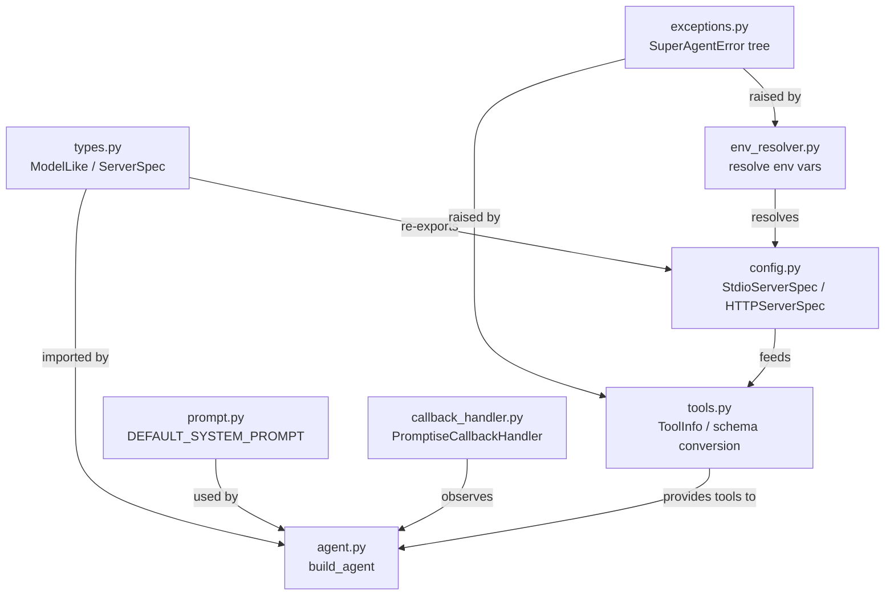

# Agent Overview

The Agent is the foundation of Promptise Foundry. `build_agent()` returns a production-ready agent with opt-in capabilities: memory, guardrails, semantic cache, reasoning patterns, approval workflows, streaming, and more. Every feature is one parameter away.

## Quick example

```python
import asyncio
from promptise import build_agent, StdioServerSpec

async def main():
    agent = await build_agent(
        model="openai:gpt-5-mini",
        servers={
            "math": StdioServerSpec(
                command="python",
                args=["-m", "my_math_server"],
            ),
        },
    )
    result = await agent.ainvoke(
        {"messages": [{"role": "user", "content": "What is 42 * 17?"}]}
    )
    print(result["messages"][-1].content)

asyncio.run(main())
```

!!! info "You need an API key first"
    Every model provider needs a credential. Put it in a `.env` file in your project (Promptise loads it automatically, in scripts and in the CLI) or pass it in code with `Model(...)`, explained in [**Models & Providers → In code: Model**](../core/agents/models.md#in-code-model): `Model("gpt-4o-mini", provider="openai", api_key="...")`. The **exact variable name for every provider** (Azure AI Foundry, Bedrock, Gemini, Ollama, …) is in [**Configuration & Secrets → Every provider's variables**](../getting-started/configuration.md#every-providers-variables); self-hosted and inference endpoints are in [**Models & Providers → Custom, self-hosted and inference endpoints**](../core/agents/models.md#custom-self-hosted-and-inference-endpoints). `promptise models env <provider>` prints the lines a provider needs and `promptise models check <model>` tells you what is still missing.

## Capability Map

Every capability is a single parameter on `build_agent()`. Start with just `model` + `servers`, then add capabilities as needed.

```
build_agent()
│
├─ Core
│   model ─────────────── "openai:gpt-5-mini", Model(...), FallbackChain([...]) or a chat model
│   servers ───────────── MCP tool servers (StdioServerSpec, HTTPServerSpec)
│   extra_tools ───────── Your own Python functions as tools (@tool)
│   instructions ──────── System prompt (a string or a Prompt)
│   identity ──────────── AgentIdentity: who the agent is
│
├─ Reasoning ──────────── How does the agent think?
│   agent_pattern ─────── "react", "verify", "managed", "code-action", "peoatr", "research", "autonomous", "deliberate", "debate", or a PromptGraph
│   node_pool ─────────── Reasoning nodes the agent picks from (autonomous graph)
│   max_agent_iterations, context_compaction, context_engine, tool_summary
│
├─ Memory & State ─────── What does the agent remember?
│   memory ────────────── InMemoryProvider, ChromaProvider, Mem0Provider
│   conversation_store ── InMemory/SQLite/Postgres/RedisConversationStore
│   cache ─────────────── SemanticCache (in-memory or Redis)
│   flow ──────────────── ConversationFlow (the system prompt changes per phase)
│
├─ Security & Safety ──── What protects the agent and its users?
│   guardrails ────────── PromptiseSecurityScanner (injection, PII, credentials, ...)
│   approval ──────────── ApprovalPolicy (human-in-the-loop for tool calls)
│   sandbox ───────────── True, a dict or a SandboxConfig (Docker isolation for code)
│
├─ Performance ────────── How fast and cost-effective?
│   optimize_tools ────── "minimal", "standard", "semantic" or a ToolOptimizationConfig
│   adaptive ──────────── True or an AdaptiveStrategyConfig (learn from failed tool calls)
│
├─ Delegation ─────────── cross_agents, include_broadcast, max_delegation_depth
│
└─ Execution ──────────── How do you watch it run?
    observe ───────────── True or an ObservabilityConfig (4 levels, 8 transporters)
    events ────────────── EventNotifier (webhooks and other sinks)
    on_tool_progress ──── Callback for MCP tool progress

Per call: ainvoke(..., caller=CallerContext(...)), chat(...), astream_with_tools(...)
```

## Which Feature Do I Need?

| I want to... | Use this |
|---|---|
| Connect to MCP tool servers | `servers=` with `StdioServerSpec` or `HTTPServerSpec` |
| Give the agent my own Python functions | `extra_tools=` with `@tool`: see [Tools](tools.md) |
| Change how the agent reasons | `agent_pattern=`: see [Reasoning Patterns](agents/reasoning-patterns.md) |
| Give the agent memory across sessions | `memory=`: see [Memory](memory.md) |
| Persist conversations | `conversation_store=`: see [Conversations](conversations.md) |
| Block prompt injection / PII leaks | `guardrails=`: see [Guardrails](guardrails.md) |
| Require human approval for actions | `approval=`: see [Approval](approval.md) |
| Run untrusted code safely | `sandbox=`: see [Sandbox](sandbox.md) |
| Reduce token costs | `optimize_tools=`: see [Tool Optimization](tool-optimization.md) |
| Cache similar queries | `cache=`: see [Semantic Cache](cache.md) |
| Handle LLM provider outages | `model=FallbackChain([...])`: see [Model Fallback](fallback.md) |
| Stream responses in real-time | `agent.astream_with_tools()`: see [Streaming](streaming.md) |
| Track token usage and latency | `observe=`: see [Observability](observability.md) |
| Multi-user access control | `caller=CallerContext(...)` on each call: see [CallerContext](agents/building-agents.md#callercontext-per-request-identity) |
| Delegate to other agents | `cross_agents=`: see [Cross-Agent Delegation](agents/cross-agent.md) |
| Get notified of errors and blocks | `events=`: see [Events](events.md) |
| Define the agent in YAML | a `.superagent` file: see [SuperAgent Files](agents/superagent-files.md) |

## How Core Modules Relate



## Module Reference

| Module | Purpose | Key Exports |
|--------|---------|-------------|
| [Config & Server Specs](config.md) | Define how to connect to MCP servers (stdio or HTTP) | `StdioServerSpec`, `HTTPServerSpec`, `servers_to_mcp_config` |
| [Types & ModelLike](types.md) | Central type aliases used across the framework | `ModelLike`, `ServerSpec`, `CrossAgent` |
| [Environment Resolver](env-resolver.md) | Resolve `${VAR}` placeholders in configuration | `resolve_env_var`, `resolve_env_in_dict` |
| [Exceptions](exceptions.md) | Custom error hierarchy for configuration and runtime errors | `SuperAgentError`, `SuperAgentValidationError` |
| [Default System Prompt](default-prompt.md) | The default instructions given to every agent | `DEFAULT_SYSTEM_PROMPT` |
| [Callback Handler](callback-handler.md) | Bridge LangChain events into the observability pipeline | `PromptiseCallbackHandler` |
| [Tools](tools.md) | Declare Python functions as tools with `@tool`; convert MCP tool schemas to LangChain tools | `tool`, `ToolError`, `ToolInfo`, `MCPClientError` |

## What's Next

- [Building Agents](agents/building-agents.md): complete `build_agent()` reference with all parameters
- [Reasoning Patterns](agents/reasoning-patterns.md): 9 built-in patterns + custom graphs
- [Reasoning Graph Engine](engine.md): nodes, edges, flags, hooks, and the execution engine
