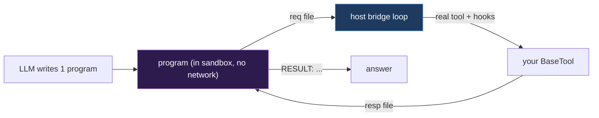

# Code-Action: one program beats a 20-call tool loop

For tasks that **gather many facts and then compute** — sum a department's
salaries, average a metric across a graph, join records across sources — a
conversational tool loop is the wrong tool. The transcript grows on every call,
the model loses the thread, re-queries the same facts, and aggregates them
unreliably in its head. Costs climb, latency climbs, accuracy drops.

`agent_pattern="code-action"` changes the **action space**: in a single LLM turn
the model writes **one Python program** over your tools and runs it in a sandbox.
Code computes exactly — loops, sums, filters, joins — so the answer is
deterministic, cheap, and fast.

!!! info "Runnable example"
    [`examples/reasoning/code_action_agent.py`](https://github.com/promptise-com/foundry/blob/main/examples/reasoning/code_action_agent.py)
    — real LLM, real Docker. Set `OPENAI_API_KEY` and have Docker running.

## Quick start

```python
from promptise import build_agent
from langchain_core.tools import tool

@tool("list_employees")
def list_employees() -> list:
    """Return a list of every employee name."""
    return [...]

@tool("get_employee")
def get_employee(name: str) -> dict:
    """Return {name, department, salary} for an employee."""
    return {...}

agent = await build_agent(
    servers={},                          # or your MCP servers
    model="openai:gpt-5-mini",
    agent_pattern="code-action",         # sandbox auto-enabled (Docker required)
    extra_tools=[list_employees, get_employee],
)

result = await agent.ainvoke({"messages": [{"role": "user", "content":
    "What is the combined salary of everyone in Engineering?"}]})
# → the model writes ONE program: list → look up each → filter → sum → print.
```

## When to use it

| Use code-action | Use `react` / `managed` instead |
|---|---|
| Sums, averages, counts over a dataset | Open-ended Q&A |
| Multi-hop joins / graph traversal | Ambiguous or conversational tasks |
| "Gather N facts, then compute" | A single tool call answers it |
| You can run Docker | No container runtime available |

It is a **pattern, not a replacement**. On tasks that are genuinely
conversational, a normal loop is better.

## Best practice: structured tools

Code-action is at its best when your tools return **structured data** — lists,
dicts, numbers — that the program can use directly:

```python
@tool("get_employee")
def get_employee(name: str) -> dict:          # ✅ program does emp["salary"]
    return {"name": name, "department": "Engineering", "salary": 210000}

@tool("get_employee")
def get_employee(name: str) -> str:           # ⚠️ program must parse prose
    return f"{name}: department=Engineering; salary=210000"
```

The bridge preserves JSON-serializable return values, so a tool that returns a
`dict` arrives in the program as a `dict` (not a stringified blob). Prose-string
tools still work — the model is told to parse them — but structured returns are
more reliable.

**MCP tools** (`servers=...`) answer with the text of the server's result, and a
server sends lists and dicts as JSON text. The bridge decodes it: when an MCP
tool's text result is valid JSON, the program gets the data (`list_orders("2026-09")`
returns a `list`, a number returns an `int` or `float`); any other text arrives
as a `str`. A tool error (an MCP error result, or a Promptise
`{"error": {"code": ..., "message": ...}}` envelope) raises in the program, with
the server's code and message (`RuntimeError: MCPToolError: NOT_FOUND: ...`).
Python tools are not decoded: a `str` they return stays a `str`.

## The security model

The model writes code, so the code runs **contained**:

- **Hardened sandbox** — the program executes in Promptise's Docker sandbox:
  read-only rootfs, dropped capabilities, Docker's default seccomp profile,
  CPU/memory/process limits, and **`network="none"`**. The network stays off
  even when you pass your own `sandbox={...}` without a `network` key. When
  `exec_timeout` expires the program's processes are killed.
- **No direct host access** — the program's *only* reach to the outside world is
  your tools, via the bridge. It can't touch the host filesystem or network.
- **Tools keep their protections** — each bridged call invokes the real
  `BaseTool` on the host. If you wrapped tools with an **approval** gate
  (`build_agent(..., approval=...)`), bridged calls trigger it too. When you run
  the agent under the **Agent Runtime**, its governance hooks (budget / health /
  audit) apply to each bridged call. *Without* the runtime, a plain agent has no
  budget hook attached — so code-action enforces its **own** hard, hook-independent
  **`max_tool_calls`** cap on each program (default 50) so a generated program can
  never loop a tool unbounded (see [The tool-call budget](#the-tool-call-budget)).

!!! warning "Honest enterprise note"
    The bridge is a deliberate capability hole: the program can call *any* tool
    the agent has, programmatically. The containment (above) means the model's
    **code** can't escape; it does **not** make your **tools** safe on its own.
    For untrusted input or multi-tenant use: keep code-action's tool set
    least-privilege, wrap mutating tools with approval, set `max_tool_calls`
    conservatively, and prefer the **gVisor** backend
    (`sandbox={"backend": "gvisor", "network": "none"}`) for kernel-level
    isolation. There is no per-run *cost* budget unless you run under the Agent
    Runtime — that, and a global concurrency limit on sandbox sessions, are the
    pieces to add before high-throughput untrusted production.



## How the bridge works

The program runs inside the container while a host loop services its tool calls
over the writable `/workspace` tmpfs:

1. The generated `promptise_tools.py` turns each of your tools into a stub: it
   writes a request file (`req_<id>.json`) and blocks.
2. A concurrent **host** loop sees the request, runs the *real* tool (with
   hooks), and writes the response (`resp_<id>.json` + a `.done` marker so reads
   never race a partial write).
3. The stub unblocks and returns the value to the program.

No network is involved — the channel is the shared filesystem, which is why the
sandbox can stay fully network-isolated.

## Repair on failure

If the program crashes, code-action feeds the **stderr** back to the model for a
bounded number of fixes (`max_repairs`, default 1) before giving up. This
recovers the common "off-by-one in the parsing" class of errors without an
unbounded loop. A program that reaches the tool-call budget is a failure too
(below). When no repair is left, the node fails and the run raises
`GraphExecutionError` (`CodeActionBudgetError` when the budget was the reason);
`ExecutionReport.error` says why the last program failed.

## The tool-call budget

`max_tool_calls` (default 50) caps the tool calls of **each program**:

- **Every call counts**: successful ones, failed ones (a tool that raised, an MCP
  error), calls to an unknown tool, and calls a `pre_tool` hook blocked.
- **Reaching it is an error, never a quiet result.** Once a program has made
  `max_tool_calls` calls, its next call raises `ToolBudgetExceeded` (a
  `RuntimeError`, importable in the program) without running the tool, and so
  does every later call. The node logs a warning, and the program's output is
  **discarded**, even if the program caught the error and printed an answer:
  it is incomplete.
- **The model is never asked to fit the data to the cap.** The prompt says each
  program has a cap on function calls, but not its value, and tells the model to
  use all the data the question needs: never skip, sample or truncate records,
  never count its own calls or stop early, and let `ToolBudgetExceeded` raise.
  (Told "at most N calls", models wrote `if calls >= N: break` or
  `orders[:N-1]`, and the partial result came back as the answer.) The error a
  refused call raises in the program does not give the value either.
- **A repair must do the whole job.** After a program reaches the cap, the model
  is asked for a program that does the **whole** job with fewer calls (a tool
  that returns many records at once, no repeated fetches), never one over part
  of the data, or to reply `CANNOT_FINISH_WITHIN_CALL_CAP` if it can't. The
  repaired program gets its own `max_tool_calls`, so a run makes at most
  `(max_repairs + 1) × max_tool_calls` calls. When an answer comes from a
  program written after a budget hit, a warning is logged on
  `promptise.engine.code_action`.
- **A job that doesn't fit fails.** If the model replies
  `CANNOT_FINISH_WITHIN_CALL_CAP`, or the last program also reaches the cap,
  the run raises `CodeActionBudgetError` (a `GraphExecutionError`, so existing
  handlers still catch it) with `max_tool_calls`, `attempts` and the `report`;
  `ExecutionReport.error` names `max_tool_calls`. Raise `max_tool_calls`, or
  give the agent a tool that returns many records per call.

```python
from promptise.engine import CodeActionBudgetError

try:
    result = await agent.ainvoke({"messages": [{"role": "user", "content": question}]})
except CodeActionBudgetError as exc:
    print(f"needs more than {exc.max_tool_calls} tool calls per program")
```

!!! note "What Promptise can and can't check"
    Promptise sees every call a program makes, so a program that reaches the
    cap is always caught, even if it catches the error. It cannot see whether a
    program that finished *within* the cap read all the data: a model that
    ignores the instructions and slices the data itself still returns a
    partial answer. Hiding the cap's value and forbidding truncation makes that
    unlikely (it removes the number a model would fit to); set
    `max_tool_calls` well above the calls the job needs.

`ExecutionReport.tool_calls` (`agent.last_report` / `engine.last_report`) counts
the calls the programs made, failed ones included; refused calls never ran and
are not counted.

## Configuration

From `build_agent`, pass `code_action=` (a dict or a
`promptise.engine.CodeActionConfig`; unknown keys are rejected):

```python
agent = await build_agent(
    servers=my_servers,
    model="openai:gpt-5-mini",
    agent_pattern="code-action",
    code_action={
        "exec_timeout": 60,    # seconds the program may run (default 120)
        "max_repairs": 2,      # self-repair attempts after a failed program (default 1)
        "max_tool_calls": 20,  # hard cap on each program's bridged tool calls (default 50)
    },
    sandbox={"memory_limit": "1G"},  # optional; network stays "none"
)
```

For a custom graph, use the factory directly:

```python
from promptise.engine import PromptGraph

PromptGraph.code_action(
    tools=my_tools,
    system_prompt="",
    sandbox_factory=...,   # injected by build_agent; supply your own for custom graphs
    max_repairs=1,         # self-repair attempts after a failed program
    exec_timeout=120,      # seconds the program may run inside the sandbox
    max_tool_calls=50,     # hard cap on each program's bridged tool calls
)
```

## Honest limits

- **Needs Docker.** `build_agent(agent_pattern="code-action")` raises a clear
  error if a sandbox can't be initialized — there is no silent fallback, because
  running model-written code outside a sandbox would be unsafe.
- **Latency floor.** Each program runs in a fresh container: starting it,
  running the program and removing it takes about 1 s on a warm Docker host,
  plus the program's own time (each repair adds another container, and
  `build_agent` starts one once to check the sandbox works). The token and
  accuracy wins dominate on real aggregation tasks, but for a one-shot lookup a
  plain `react` call is snappier.
- **Not magic on reasoning.** Code-action makes the *computation* exact; it does
  not make the model's *plan* smarter. If the task is ambiguous, clarify it
  first.

## See also

- [Reasoning Patterns](../core/agents/reasoning-patterns.md) — all 10 built-in patterns
- [Prebuilt Patterns](../core/engine-prebuilts.md#code-action-one-sandboxed-program) — the factory
- [Context Lifecycle Management](context-lifecycle.md) — the broader cost/rot story
- [Sandbox](../core/sandbox.md) — the container security layers code-action runs on
