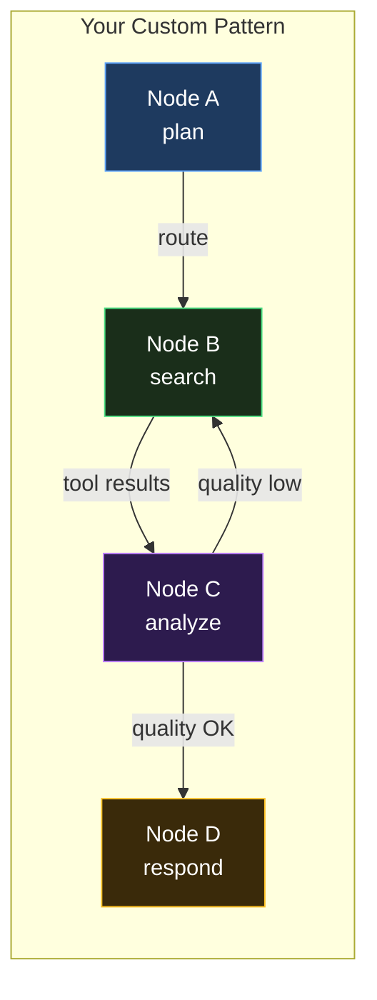
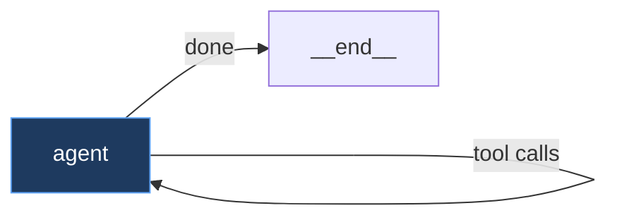
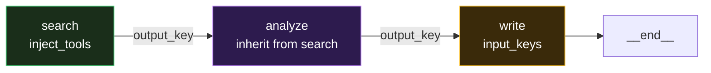
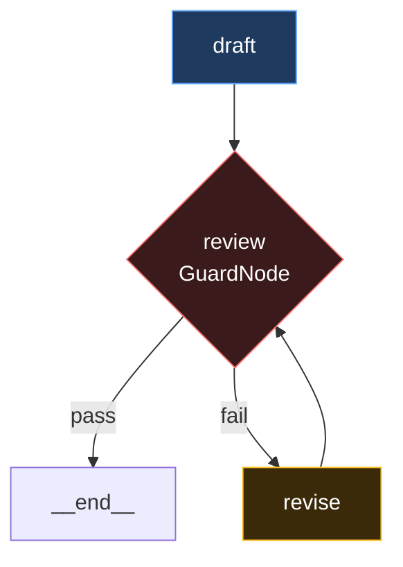
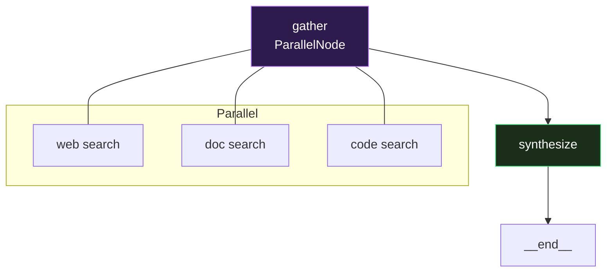
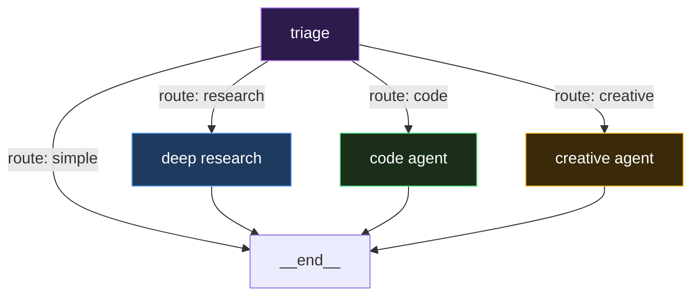

# Building Custom Agentic Reasoning Patterns

This guide shows how to build your own agent reasoning strategies using the Reasoning Graph, from simple tool-calling agents to sophisticated multi-stage reasoning systems.

## Concepts

A **reasoning pattern** is a graph of nodes. Each node is a complete processing unit. The engine traverses the graph, executing nodes and following edges. The LLM decides the path at runtime.



Each node controls:

- **What the LLM sees**: blocks, strategy, perspective, context layers
- **What the LLM can do**: tools, tool_choice, inject_tools
- **What the LLM must produce**: output_schema, guards
- **How data flows**: input_keys, output_key, inherit_context_from
- **Pre/post processing**: preprocessor, postprocessor
- **Where to go next**: transitions, default_next, LLM-routed

## Example 1: Simple Tool Agent



The simplest pattern, one node with tools:

```python
from promptise.engine import PromptGraph, PromptNode

graph = PromptGraph("simple-agent")
graph.add_node(PromptNode(
    "agent",
    instructions="You are a helpful assistant. Use tools to answer questions.",
    tools=my_tools,
    default_next="__end__",  # A tool-free answer ends the run
))
graph.set_entry("agent")
```

The engine handles everything: LLM calls, tool execution, re-entry, termination. After a turn with tool calls the engine re-enters the node on its own, so `default_next` only decides what happens after the final answer.

## Example 2: Research Pipeline



Three stages with data flow between nodes:

```python
from promptise.engine import PromptGraph, PromptNode
from promptise.prompts import chain_of_thought

from pydantic import BaseModel


class Analysis(BaseModel):
    key_findings: list[str]
    open_questions: list[str]


graph = PromptGraph("researcher", mode="static")

# Stage 1: Search (has tools). Its final reply text lands in state.context["search_output"].
graph.add_node(PromptNode(
    "search",
    instructions="Search for information about the topic, then summarize what you found.",
    tools=search_tools,
    default_next="analyze",
))

# Stage 2: Analyze (reads the search summary, no tools, structured output)
graph.add_node(PromptNode(
    "analyze",
    instructions="Analyze the search results. Identify key findings.",
    inherit_context_from="search",    # Reads state.context["search_output"]
    output_schema=Analysis,
    output_key="analysis",            # The parsed Analysis dict
    default_next="write",
))

# Stage 3: Write (reads the analysis, produces the final answer)
graph.add_node(PromptNode(
    "write",
    instructions="Write a comprehensive answer based on the analysis.",
    input_keys=["analysis"],
    strategy=chain_of_thought,
    default_next="__end__",
))

graph.set_entry("search")
```

`output_key` holds the node's output: the parsed `Analysis` dict here, the
reply text for a plain-text node. `inherit_context_from` reads the other
side, `state.context["{name}_output"]`, which every `PromptNode` writes (its
reply text, or its structured output as JSON).

## Example 3: Quality-Controlled Output



Add a guard node for quality control with retry:

```python
from promptise.engine import PromptNode, GuardNode, PromptGraph
from promptise.prompts.guards import ContentFilterGuard, LengthGuard

graph = PromptGraph("quality-agent", mode="static")

graph.add_node(PromptNode(
    "draft",
    instructions="Write a technical blog post about the topic, with an introduction and a conclusion.",
    tools=research_tools,
    default_next="review",
))

# No model call: checks the last message (the latest draft) and routes.
graph.add_node(GuardNode(
    "review",
    guards=[
        LengthGuard(min_length=500, max_length=3000),
        ContentFilterGuard(required=["conclusion", "introduction"]),
    ],
    on_pass="__end__",
    on_fail="revise",
))

graph.add_node(PromptNode(
    "revise",
    instructions=("The draft failed review: it must be 500-3000 characters and contain the "
                  "words 'introduction' and 'conclusion'. Rewrite it."),
    inherit_context_from="draft",
    default_next="review",
    max_iterations=3,                # at most 3 revisions,
    transitions={"error": "__end__"},  # then stop with the last draft
))

graph.set_entry("draft")
```

`GuardNode` does not write the guard messages anywhere the model reads, so put
the rules in the reviser's instructions (or read
`state.node_history[-1].guards_failed` in a custom node). The run ends on the
last message, so the reply is the latest draft.

## Example 4: Parallel Research



Search multiple sources simultaneously. Each child runs one model call: a
child that calls a tool runs it, but does not get a second turn to read the
result. The successful tool results go to `state.observations`, and
`synthesize` (a node without tools) sees the latest five in its prompt:

```python
from promptise.engine import PromptNode, ParallelNode, PromptGraph
from promptise.prompts import chain_of_thought, self_critique

graph = PromptGraph("parallel-research", mode="static")

graph.add_node(ParallelNode(
    "gather",
    nodes=[
        PromptNode("web", tools=[web_search], instructions="Search the web."),
        PromptNode("docs", tools=[doc_search], instructions="Search documentation."),
        PromptNode("code", tools=[code_search], instructions="Search codebases."),
    ],
    default_next="synthesize",
))

graph.add_node(PromptNode(
    "synthesize",
    instructions="Combine findings from all three sources.",
    include_observations=True,
    strategy=chain_of_thought + self_critique,
    default_next="__end__",
))

graph.set_entry("gather")
```

## Example 5: Dynamic LLM Routing



The LLM decides where to go at each step. Give the node an `output_schema` with a `route` field: the engine follows the transition whose key the model picks (a node name works too). Without a schema the reply is plain text and the route is never read.

```python
from typing import Literal

from pydantic import BaseModel

from promptise.engine import PromptGraph, PromptNode
from promptise.prompts import creative


class Triage(BaseModel):
    route: Literal["simple_answer", "research", "code_task", "creative"]


graph = PromptGraph("dynamic-agent", mode="static")

graph.add_node(PromptNode(
    "triage",
    instructions="Analyze the user's request and decide the approach.",
    output_schema=Triage,
    transitions={
        "simple_answer": "__end__",
        "research": "deep_research",
        "code_task": "code_agent",
        "creative": "creative_agent",
    },
))

graph.add_node(PromptNode("deep_research", tools=search_tools, default_next="__end__"))
graph.add_node(PromptNode("code_agent", tools=code_tools, default_next="__end__"))
graph.add_node(PromptNode("creative_agent", perspective=creative, default_next="__end__"))

graph.set_entry("triage")
```

## Example 6: Custom Preprocessing

Transform data before the LLM sees it:

```python
from datetime import datetime


async def load_customer_data(state, config):
    """Preprocessor: load customer data into context."""
    customer_id = state.context.get("customer_id")
    if customer_id:
        data = await crm.get_customer(customer_id)
        state.context["customer_name"] = data.name
        state.context["customer_tier"] = data.tier
        state.context["customer_history"] = data.recent_tickets[:5]

async def format_ticket(output, state, config):
    """Postprocessor: format the reply as a support ticket."""
    return {
        "ticket_id": generate_id(),
        "customer": state.context.get("customer_name"),
        # output is the reply text (also in state.context["support_output"])
        "resolution": output,
        "created_at": datetime.now().isoformat(),
    }

graph.add_node(PromptNode(
    "support",
    instructions="Resolve the customer's issue.",
    tools=support_tools,
    preprocessor=load_customer_data,
    postprocessor=format_ticket,
    output_key="ticket",
    default_next="__end__",
))
```

## Example 7: Custom Node Type

Build a completely custom node:

```python
from promptise.engine import BaseNode, GraphState, NodeResult

class APICallNode(BaseNode):
    """A node that calls an external API and processes the response."""

    def __init__(self, name, *, endpoint, headers=None, **kwargs):
        super().__init__(name, **kwargs)
        self.endpoint = endpoint
        self.headers = headers or {}

    async def execute(self, state, config):
        import httpx

        params = {k: state.context[k] for k in state.context if not k.startswith("_")}

        async with httpx.AsyncClient() as client:
            resp = await client.get(self.endpoint, params=params, headers=self.headers)
            data = resp.json()

        state.context[f"{self.name}_result"] = data
        state.observations.append({"tool": self.name, "result": str(data)[:500], "success": True})

        return NodeResult(node_name=self.name, node_type="api_call", output=data)

# Use it in a graph
graph.add_node(APICallNode("weather", endpoint="https://api.weather.com/current"))
graph.add_node(PromptNode("respond", inherit_context_from="weather"))
graph.always("weather", "respond")
```

## Example 8: Using the Graph with build_agent

```python
from promptise import build_agent
from promptise.config import HTTPServerSpec
from promptise.engine import PromptGraph, PromptNode
from promptise.prompts.blocks import Identity, Rules

# Build your custom graph
graph = PromptGraph("my-agent")
graph.add_node(PromptNode(
    "main",
    blocks=[
        Identity("Senior data analyst"),
        Rules(["Always cite sources", "Include confidence levels"]),
    ],
    inject_tools=True,  # Receives the tools build_agent discovers
    default_next="__end__",
))
graph.set_entry("main")

# Pass it to build_agent: nodes with inject_tools=True get the MCP tools
agent = await build_agent(
    model="openai:gpt-5-mini",
    servers={"analytics": HTTPServerSpec(url="http://localhost:8000/mcp")},
    agent_pattern=graph,
)

result = await agent.ainvoke({"messages": [{"role": "user", "content": "Analyze Q4 trends"}]})
```

## Debugging

### Graph Visualization

```python
print(graph.describe())
print(graph.to_mermaid())
```

### Validate before you run

```python
problems = graph.validate()   # [] when the entry, edges and transitions all resolve
assert not problems, problems
```

### Execution Report

```python
from promptise import resolve_model
from promptise.engine import PromptGraphEngine

engine = PromptGraphEngine(graph, resolve_model("openai:gpt-5-mini"))
result = await engine.ainvoke({"messages": [{"role": "user", "content": "Analyze Q4 trends"}]})
print(engine.last_report.summary())
```

### Step-by-Step Inspection

A `post_node` hook sees every node's `NodeResult` as the run goes:

```python
from promptise.engine import PromptGraphEngine


class PrintSteps:
    async def post_node(self, node, result, state):
        print(f"{result.node_name}: {result.duration_ms:.0f}ms, tokens={result.total_tokens}, "
              f"tools={len(result.tool_calls)}")
        return result


engine = PromptGraphEngine(graph=graph, model=model, hooks=[PrintSteps()])
result = await engine.ainvoke({"messages": [{"role": "user", "content": "Analyze Q4 trends"}]})
```

### Hooks for Debugging

```python
from promptise.engine import LoggingHook

engine = PromptGraphEngine(
    graph=graph,
    model=model,
    hooks=[LoggingHook()],  # Logs every node entry/exit
)
```

## Production Hardening

### Node Flags for Safety

Use [typed flags](../core/engine-flags.md) to make graphs production-safe:

```python
from promptise.engine import NodeFlag, PromptGraph, PromptNode
from promptise.engine.reasoning_nodes import ThinkNode, SynthesizeNode

graph = PromptGraph("production-safe", nodes=[
    # Must succeed: abort graph on failure
    ThinkNode("plan", is_entry=True, flags={NodeFlag.CRITICAL}),

    # Retry a failed model call with exponential backoff (up to max_iterations attempts)
    PromptNode("fetch_data", inject_tools=True, max_iterations=3,
               flags={NodeFlag.RETRYABLE, NodeFlag.OBSERVABLE}),

    # Skip enrichment if fetch failed: don't block the pipeline
    PromptNode("enrich", flags={NodeFlag.SKIP_ON_ERROR}),

    # Cache within the run: a revisit with the same input_keys values reuses the result
    PromptNode("analyze", flags={NodeFlag.CACHEABLE},
               input_keys=["data"]),

    # Final answer with a smaller model
    SynthesizeNode("answer", is_terminal=True,
                   model_override="openai:gpt-5-mini"),
])
```

### Processors for Data Quality

```python
from pydantic import BaseModel

from promptise.engine import PromptNode
from promptise.engine.processors import (
    chain_postprocessors, chain_preprocessors, context_enricher, json_extractor,
    state_summarizer, state_writer,
)


class Report(BaseModel):
    answer: str
    confidence: float
    sources: list[str]


PromptNode("analyze",
    output_schema=Report,
    input_keys=["data"],
    # Before the LLM call: cap long context values, add timestamp/iteration
    preprocessor=chain_preprocessors(
        state_summarizer(max_context_chars=4000),
        context_enricher(),
    ),
    # After: keep the fields you need, copy the answer into state.context
    postprocessor=chain_postprocessors(
        json_extractor(keys=["answer", "sources"]),
        state_writer(fields={"answer": "final_answer"}),
    ),
)
```

A preprocessor that raises fails the node before the model is called, so a
validator such as `input_validator()` stops it; a postprocessor's exception is
logged and the output kept. See [Processors](../core/engine-processors.md).

### Budget and Metrics Hooks

```python
from promptise.engine import PromptGraphEngine, MetricsHook, BudgetHook

metrics = MetricsHook()
engine = PromptGraphEngine(
    graph=graph,
    model=model,
    hooks=[
        metrics,
        BudgetHook(max_tokens=50000, max_cost_usd=0.50),
    ],
)

result = await engine.ainvoke({"messages": [{"role": "user", "content": "Analyze Q4 trends"}]})

# Inspect per-node performance
for node_name, stats in metrics.summary().items():
    print(f"{node_name}: {stats['calls']} calls, "
          f"{stats['total_tokens']} tokens, "
          f"{stats['total_duration_ms']:.0f}ms")
```

### Error Handling

A run that ends on a failed node (a provider error, a CRITICAL node, a RETRYABLE node out of attempts) raises `GraphExecutionError`, which carries the run's report:

```python
from promptise.engine import GraphExecutionError

try:
    result = await engine.ainvoke({"messages": [{"role": "user", "content": "Analyze Q4 trends"}]})
except GraphExecutionError as exc:
    print(f"Graph failed at {exc.node_name}: {exc.error}")
    report = exc.report
else:
    report = engine.last_report

print(report.summary())  # path, tokens, tool calls, guards
```

An agent from `build_agent` raises the same exceptions from `agent.ainvoke()`;
the report of a failed agent run is `exc.report`.

## Best Practices

1. **Start simple**: Use `PromptGraph.react()` first. Add complexity only when needed.
2. **One responsibility per node**: Each node should do ONE thing well.
3. **Use output_key/input_keys**: Explicit data flow is easier to debug than implicit state.
4. **Set max_iterations**: Every node that can loop should have a limit.
5. **Add guards**: Validate output at key checkpoints, not just at the end.
6. **Use flags for safety**: `CRITICAL` for must-succeed nodes, `RETRYABLE` for flaky calls, `SKIP_ON_ERROR` for optional steps.
7. **Use hooks for cross-cutting concerns**: Logging, timing, metrics, budget enforcement.
8. **Test incrementally**: Test each node in isolation, then the graph.
9. **Use model_override for cost**: Cheap models for routing/classification, expensive for reasoning/synthesis.
10. **Cap everything**: Observations (capped at 50), reflections (capped at 5), node iterations, total iterations.
11. **Give routing nodes a schema**: `route`, pass/fail and severity are read from structured output only.
12. **Call `graph.validate()`** in a test, it catches typos in edge and transition targets before a run does.

!!! tip "Learn the concept"

    - [AI Agent Reasoning Patterns in Python: From ReAct to Debate](https://www.promptise.com/guides/view/ai-agent-reasoning-patterns) -- How the prebuilt reasoning patterns work and how to choose one.
    - [Plan-and-Execute Agents in Python: Beyond the ReAct Loop](https://www.promptise.com/guides/view/plan-and-execute-agent-python) -- A plan, act, verify, reflect graph compared with ReAct.
