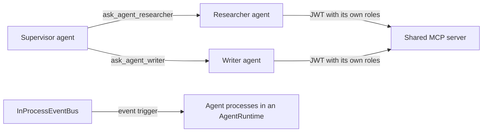

# Multi-Agent Coordination

A multi-agent system splits work across agents with different instructions, tools or permissions, and coordinates them. Promptise gives you four building blocks for that: a **shared MCP server** that authorizes each agent separately, **delegation** to peer agents through generated tools, **events** that wake agent processes in a runtime, and **state** that your coordinating code reads and writes. This guide shows each one with working code, then combines them into common patterns.



Start with one agent. Add a second only when the work needs different instructions, tools or permissions; every extra agent adds model calls and a hand-off where context can be lost.

---

## 1. A shared MCP server with per-agent roles

Several agents can call the same MCP server. Give each agent its own token, and let the server decide which tools each one may call. The server checks a JWT and the role claims in it:

```python title="team_tools.py"
from promptise.mcp.server import AuthMiddleware, HasRole, JWTAuth, MCPServer

jwt_auth = JWTAuth(secret="change-me-shared-secret")

server = MCPServer(name="team-tools")
server.add_middleware(AuthMiddleware(jwt_auth))


@server.tool(auth=True, guards=[HasRole("researcher")])
async def web_search(query: str) -> str:
    """Search the web (researcher role only)."""
    return f"3 results for {query!r}"


@server.tool(auth=True, guards=[HasRole("writer")])
async def publish(title: str, body: str) -> str:
    """Publish an article (writer role only)."""
    return f"Published {title!r}"


if __name__ == "__main__":
    server.run(transport="http", host="127.0.0.1", port=8080)
```

Each agent connects with a token that carries its roles. `JWTAuth.create_token()` is a test helper; in production the tokens come from your identity provider (see [Agent Identity](../identity/overview.md), which presents a per-agent credential to MCP servers for you):

```python
from promptise import HTTPServerSpec, build_agent
from promptise.mcp.server import JWTAuth

jwt_auth = JWTAuth(secret="change-me-shared-secret")


def tools_for(agent_name: str, *roles: str) -> dict:
    token = jwt_auth.create_token({"sub": agent_name, "roles": list(roles)})
    return {"tools": HTTPServerSpec(url="http://127.0.0.1:8080/mcp", bearer_token=token)}


researcher = await build_agent(model="openai:gpt-5-mini", servers=tools_for("researcher", "researcher"))
writer = await build_agent(model="openai:gpt-5-mini", servers=tools_for("writer", "writer"))
```

A guard that fails refuses the call: the researcher can't call `publish`, and the server records which agent tried. With `MCPServer(hide_unauthorized_tools=True)` an agent doesn't even see the tools it can't call. See [MCP Server Authentication](../mcp/server/auth-security.md) for roles, scopes and `JwksAuth`.

---

## 2. Delegation to peer agents

`build_agent(cross_agents=...)` gives an agent one tool per peer, `ask_agent_<name>`, that sends a message to that peer and returns its final answer. The peers are ordinary agents in the same Python process, wrapped in `CrossAgent(agent, description="", timeout=None)`:

```python
import asyncio

from promptise import build_agent
from promptise.cross_agent import CrossAgent


async def main():
    researcher = await build_agent(
        model="openai:gpt-5-mini",
        instructions="You collect three short, factual bullet points on a topic.",
    )
    writer = await build_agent(
        model="openai:gpt-5-mini",
        instructions="You turn bullet points into one clear paragraph.",
    )
    supervisor = await build_agent(
        model="openai:gpt-5-mini",
        instructions=(
            "You coordinate a researcher and a writer. Ask the researcher for facts, "
            "then ask the writer to turn them into a paragraph. Return the paragraph."
        ),
        cross_agents={
            "researcher": CrossAgent(agent=researcher, description="Collects facts", timeout=60),
            "writer": CrossAgent(agent=writer, description="Writes prose", timeout=60),
        },
        delegation_timeout=90,   # default timeout for every peer without its own
        max_delegation_depth=3,  # default: supervisor -> peer -> peer -> peer
    )
    result = await supervisor.ainvoke(
        {"messages": [{"role": "user", "content": "Write a paragraph about solar batteries."}]}
    )
    print(result["messages"][-1].content)
    for agent in (supervisor, researcher, writer):
        await agent.shutdown()


asyncio.run(main())
```

| `build_agent` parameter | Default | Effect |
|---|---|---|
| `cross_agents` | `None` | `{name: CrossAgent}`; adds `ask_agent_<name>(message, context=None)` per peer |
| `include_broadcast` | `False` | Also adds `broadcast_to_agents`, which sends one message to several peers in parallel and returns each peer's answer |
| `delegation_timeout` | `None` | Seconds a peer may take when its `CrossAgent.timeout` is not set |
| `max_delegation_depth` | `3` | Nested delegations allowed; a deeper call, or a call back into a peer already working on the request, raises `DelegationError` |

A peer that times out returns the text `Timed out waiting for peer agent reply.` to the caller, so the supervisor can carry on or try another peer. With `identity=` on the caller, the peer's observability timeline records who delegated (`delegated_by`). See [Cross-Agent Delegation](../core/agents/cross-agent.md) for every option.

---

## 3. Event-driven agent processes

For agents that run continuously, put each one in an [`AgentRuntime`](../runtime/runtime-manager.md) process and wake it with an `event` trigger. The runtime doesn't create an event bus; pass one. `InProcessEventBus` delivers events between everything in one Python process:

```python
from promptise.runtime import AgentRuntime, InProcessEventBus, ProcessConfig, TriggerConfig

bus = InProcessEventBus()
runtime = AgentRuntime(event_bus=bus)

await runtime.add_process("triage", ProcessConfig(
    model="openai:gpt-5-mini",
    instructions="You triage incoming incidents and say how urgent they are.",
    triggers=[TriggerConfig(
        type="event",
        event_type="incident.opened",
        filter_expression="data.severity in ['high', 'critical']",  # skip the rest before any model call
    )],
))
await runtime.start_all()

# Anything in the same Python process can emit: your web handler, a scheduler, another agent's tool
await bus.emit("incident.opened", {"id": "INC-42", "severity": "high"}, source="pager")
```

Each event becomes one run of the process, with the event as its untrusted input. The trigger's payload is `{"event_type", "event_id", "source", "data"}`; `event_source="pager"` on the trigger keeps only events from that source.

To react to what *other processes* do, forward the runtime's own events to the bus with an `EventBusSink`. Here a responder wakes whenever another process fails:

```python
from promptise import EventNotifier
from promptise.events import EventBusSink
from promptise.runtime import AgentRuntime, InProcessEventBus, ProcessConfig, TriggerConfig

bus = InProcessEventBus()
notifier = EventNotifier(sinks=[EventBusSink(bus, events=["process.failed"])])
runtime = AgentRuntime(event_bus=bus, event_notifier=notifier)

await runtime.add_process("responder", ProcessConfig(
    model="openai:gpt-5-mini",
    instructions="A process failed. Summarize the error for the on-call engineer.",
    triggers=[TriggerConfig(type="event", event_type="process.failed")],
))
```

The forwarded event's `data` is the full event dict, including `agent_id` (the failed process's name) and `data.error`. Events, buses and filters are covered on [Event and Webhook Triggers](../runtime/triggers/event-webhook.md).

---

## 4. Sharing state between agents

Each process has its own [`AgentContext`](../runtime/context.md): key-value state shown to the agent on every run. There is no state object shared by several processes. Share facts in one of three ways:

- **In the event payload**: the producer puts what the next agent needs into the event.
- **Through your coordinating code**: read one process's context and write another's. `writable_keys` limits what the agent itself may change; your code writes with its own `source`, so the audit trail shows who wrote what.
- **Through a shared MCP server**: a store behind tools, with per-agent roles as in section 1.

```python
researcher = runtime.get_process("researcher")
writer = runtime.get_process("writer")

findings = researcher.context.get("findings")
writer.context.put("brief", findings, source="coordinator")   # recorded with source "coordinator"
print(writer.context.state_history("brief")[-1].source)       # coordinator
```

An agent writes its own state only through the `update_state` tool, which `ContextConfig(state_tool=True, writable_keys=[...])` gives it.

---

## 5. A staged pipeline

Stages that run one after the other combine the pieces above: each stage is a process with an `event` trigger and a state tool for its result, and one runtime-wide hook starts the next stage when a run succeeds.

```python
import asyncio

from promptise.runtime import (
    AgentRuntime, HookContext, HookEvent, HookManager, InProcessEventBus, ProcessConfig, TriggerConfig,
)
from promptise.runtime.config import ContextConfig

STAGES = ["outline", "draft"]                      # outline runs first, then draft
bus = InProcessEventBus()
hooks = HookManager()


def stage(name: str, instructions: str) -> ProcessConfig:
    return ProcessConfig(
        model="openai:gpt-5-mini",
        instructions=instructions + " Save your result with update_state('result', ...).",
        triggers=[TriggerConfig(type="event", event_type=f"{name}.start")],
        context=ContextConfig(state_tool=True, writable_keys=["result"]),
    )


async def main():
    runtime = AgentRuntime(event_bus=bus, hooks=hooks)

    @hooks.on(HookEvent.TASK_COMPLETED)
    async def next_stage(ctx: HookContext) -> None:
        if ctx.data["outcome"] != "success" or ctx.process_id not in STAGES:
            return
        result = runtime.get_process(ctx.process_id).context.get("result")
        index = STAGES.index(ctx.process_id)
        if index + 1 < len(STAGES):
            asyncio.create_task(bus.emit(f"{STAGES[index + 1]}.start", {"input": result}))
        else:
            print("Pipeline finished:\n", result)

    await runtime.add_process("outline", stage("outline", "Write a 3-point outline for the topic in the event."))
    await runtime.add_process("draft", stage("draft", "Write a short paragraph from the outline in the event."))
    await runtime.start_all()

    await bus.emit("outline.start", {"topic": "Why teams journal agent runs"})
    await asyncio.sleep(60)          # in a service: await runtime.run_forever()
    await runtime.shutdown()


asyncio.run(main())
```

The hook emits from a background task (`asyncio.create_task`), so the finished run doesn't wait for the next stage. A stage that fails doesn't start the next one; its event goes to the process's [dead letters](../runtime/processes.md#dead-letters), and you can redeliver it after a fix.

---

## Patterns

### Fan-out / fan-in

Ask several peers the same question and merge the answers. With `include_broadcast=True`, the model gets a `broadcast_to_agents` tool that does it in one call, in parallel, and captures each peer's timeout or error separately so one slow peer doesn't fail the rest:

```python
reviewer_names = ["security", "performance", "style"]
reviewers = {
    name: CrossAgent(agent=await build_agent(
        model="openai:gpt-5-mini", instructions=f"You review code for {name} issues only.",
    ), description=f"{name} review", timeout=60)
    for name in reviewer_names
}
lead = await build_agent(
    model="openai:gpt-5-mini",
    instructions="Send the code to every reviewer at once, then merge their findings into one list.",
    cross_agents=reviewers,
    include_broadcast=True,
)
```

### Supervisor

One agent plans and delegates; the peers each have narrow instructions and only the tools they need. This is the example in section 2. Keep the supervisor's own tool list short, so it delegates instead of doing the work itself.

### Pipeline with quality gates

Add a reviewing stage between producing stages, and let the hook in section 5 move on only when the reviewer's state says so (for example `approved: true` in its context), or emit the earlier stage's event again with the reviewer's notes.

---

## Common pitfalls

- **Too many agents.** Each hand-off costs model calls and loses context the peer never saw. Pass the facts a peer needs in the message or the `context` argument.
- **Unbounded delegation.** Without a `timeout` on each `CrossAgent` (or `delegation_timeout`), a stuck peer stalls the caller. Set one.
- **One shared token for every agent.** The server can't tell the agents apart. Give each agent its own credential and roles.
- **Expecting a shared state object.** Processes don't share an `AgentContext`. Pass data in events, through your code, or through an MCP tool.
- **Awaiting the next stage inside a hook.** A hook runs while the process finishes its run. Schedule follow-up work with `asyncio.create_task`.
- **Event triggers without a bus.** `AgentRuntime()` without `event_bus=` can't start a process with an `event` trigger.

---

## When to use what

| Building block | Use when |
|---|---|
| **Shared MCP server** | Agents need the same tools with different permissions |
| **`ask_agent_<name>`** (cross agents) | One agent needs an answer from a specialist agent |
| **`broadcast_to_agents`** | Several agents should handle the same input in parallel |
| **Events in an `AgentRuntime`** | Long-running agents react to things that happen, without knowing who produced them |
| **Coordinating code and context** | Your code decides what each agent sees and records who changed what |

## Related

- [Cross-Agent Delegation](../core/agents/cross-agent.md)
- [Agent Runtime](../runtime/index.md) and [Runtime Hooks](../runtime/hooks.md)
- [Event and Webhook Triggers](../runtime/triggers/event-webhook.md)
- [MCP Server Authentication](../mcp/server/auth-security.md)
- [Agent Identity](../identity/overview.md)

!!! tip "Learn the concept"

    - [Build a Multi-Agent System in Python (and When Not To)](https://www.promptise.com/guides/view/multi-agent-system-python): a coordinator with specialist agents, and what it really costs.
    - [LLM Agent Orchestration Patterns: Supervisor, Handoff](https://www.promptise.com/guides/view/llm-agent-orchestration): supervisor, routing and handoff patterns, and when each fits.
