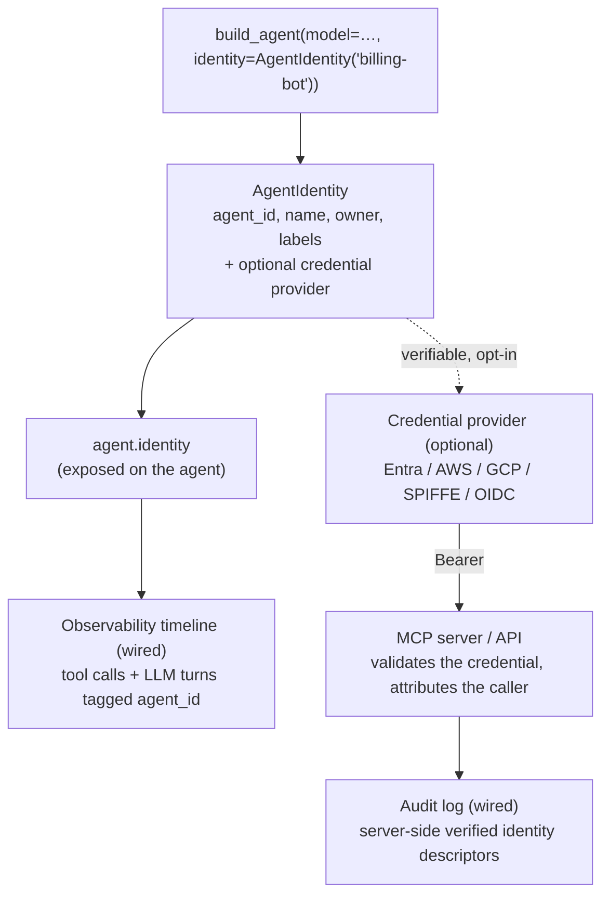

# Agent Identity Architecture

Agent Identity has two jobs: **attribute** every action to the acting
agent, and (optionally) **present** a verifiable credential to the
resources the agent calls. The identity itself is a small object; the
value is in where it flows.

## Attribution path



When you pass `identity=` to `build_agent`, the agent's `agent_id`
becomes the default attribution id for the observability timeline
(unless you set `observer_agent_id` explicitly). No further wiring is
needed: the observability subsystem already records every tool call and
LLM turn with an `agent_id`; identity just supplies it.

On the **server** side, the Guardrails `AuditMiddleware` records the
**verified** caller's identity descriptors (`subject` / `issuer` /
`audience` / `roles`, taken from the validated JWT) inside each
tamper-evident, HMAC-chained audit entry. Only identity *descriptors* are
recorded, never the token or the full claim set (which may carry
sensitive data). So server-side audit answers *which agent did what*, not
just a `client_id` string.

## Two tiers

- **Local**: `AgentIdentity("billing-bot", …)`. Pure attribution; needs
  no infrastructure. Used to tag traces and audit entries.
- **Verifiable**: `AgentIdentity.from_entra(...)` (or `from_aws`,
  `from_gcp`, `from_spiffe`, `from_oidc`, `auto`). Adds a credential
  provider that mints a signed JWT proving the identity, for resources
  that must authenticate the caller rather than trust a self-asserted id.

## Credential lifecycle

A verifiable identity's credential is a short-lived JWT. The framework
caches one credential **per audience** per provider and re-acquires it as
it nears expiry:

- The expiry is read from the JWT's standard `exp` claim
  (`decode_jwt_expiry`); a credential is re-acquired once it is within
  `CREDENTIAL_REFRESH_BUFFER_SECONDS` (60s) of expiry, or within half
  its lifetime, for a credential that lives less than two minutes.
- Asking for no audience and asking for the provider's default audience
  share one cached credential. Passive sources (projected-token files,
  OIDC), whose audience is fixed, keep a single entry for every audience.
- `get_credential(audience, force_refresh=True)` skips the cache, for a
  credential a resource rejected before its `exp` (a revoked or rotated
  key, clock skew). `build_agent` does this once when an MCP server
  answers `401`.
- A credential with no decodable `exp` (an opaque token, or a
  file-projected token rotated in place by the platform) is treated as
  always-stale and re-acquired on every use, so rotation is always
  observed.

Concurrent callers collapse into a single acquisition via a lock, and
the cache is process-local.

## Per-resource credentials

One agent often calls several resources (a billing MCP server, a CRM
API), and each may require a credential minted for *its* audience. A
verifiable identity serves all of them from a single `AgentIdentity`:

```python
identity.get_credential()                      # the provider's default audience
identity.get_credential("api://billing")       # scoped to the billing resource
identity.auth_header("api://crm")              # {"Authorization": "Bearer <jwt for crm>"}
```

What `audience` does depends on the provider:

| Provider kind | Providers | `audience=` behaviour |
| --- | --- | --- |
| **Active** (re-mints on demand) | Entra IMDS, AWS STS, GCP metadata, SPIFFE SDK | Mints a credential scoped to the requested audience; falls back to the factory default when omitted. |
| **Passive** (fixed audience) | EKS / AKS projected-token files, OIDC file / env / callable | The audience is fixed at issue time by the platform; a per-request `audience` is accepted but ignored. |

Each distinct audience is cached and refreshed independently (keyed by
`audience`, each entry expiring on its own `exp`), so repeated calls to
the same resource reuse a token while different resources get their own.

!!! note "Passive providers stay single-audience"
    A projected-token or OIDC-file identity has exactly the audience the
    platform stamped into the token. If you need a *different* audience
    from such a source, issue a token for it at the source (a second
    projected-token volume, a different CI claim) and build a second
    identity. Promptise cannot re-mint what it did not sign.

## Auto-detection

`AgentIdentity.auto(agent_id)` picks a credential provider from
environment markers, in a fixed precedence order, with **no
metadata-server probe** (fast, offline-safe):

| Order | Platform | Markers |
| --- | --- | --- |
| 1 | Entra | `AZURE_FEDERATED_TOKEN_FILE`, `AZURE_CLIENT_ID` |
| 2 | AWS | `AWS_LAMBDA_FUNCTION_NAME`, `AWS_EXECUTION_ENV`, `EKS_POD_NAME`, `AWS_WEB_IDENTITY_TOKEN_FILE`, `PROMPTISE_IDENTITY_TOKEN_FILE` |
| 3 | GCP | `GOOGLE_CLOUD_PROJECT`, `K_SERVICE`, `GCE_METADATA_IP` |
| 4 | SPIFFE | `SPIFFE_ENDPOINT_SOCKET` |

A variable set to the empty string counts as unset. On AWS, `PROMPTISE_IDENTITY_TOKEN_FILE` selects the EKS-projected mode; every other AWS marker selects STS (IRSA's own `AWS_WEB_IDENTITY_TOKEN_FILE` token is never presented: its audience is `sts.amazonaws.com`). On SPIFFE, `auto()` uses SDK mode, so it needs py-spiffe. Each platform is built with its factory defaults (audience or resource `api://promptise-agent`); use the explicit factory when you need another audience.

The first match wins; if none match, `auto()` raises
[`PlatformDetectionError`](security.md#errors); construct a local
`AgentIdentity(agent_id)` or use an explicit factory instead.

## MCP integration

A verifiable identity is presented to MCP servers as a bearer credential
**automatically**: when you pass `identity=` to `build_agent`, every MCP
server that has no credential of its own receives the agent's credential as
its `bearer_token` (an explicit per-server `bearer_token`, `api_key`, or
`Authorization` / `x-api-key` header always wins). The
credential is requested per request, not once at build time: it is renewed
before it expires (the session is reopened with it), refreshed once when a
server answers `401`, and a request for which no credential can be acquired
fails with `MCPCredentialError` rather than being sent unauthenticated.

Each server's credential is scoped to that server's
[`HTTPServerSpec.audience`](../core/config.md#httpserverspec), so a
single identity presents a `billing`-scoped token to the billing server
and a `crm`-scoped token to the CRM server, all from one `AgentIdentity`:

```python
from promptise.config import HTTPServerSpec

agent = await build_agent(
    model="openai:gpt-5-mini",
    identity=identity,
    servers={
        "billing": HTTPServerSpec(url="https://billing.internal/mcp",
                                  audience="api://billing"),
        "crm":     HTTPServerSpec(url="https://crm.internal/mcp",
                                  audience="api://crm"),
    },
)
```

Leave `audience` unset to use the identity provider's default audience.
If the IdP is unreachable when a credential must be acquired, the request
is not sent: it fails with `MCPCredentialError` (transient metadata and STS
errors are retried a few times first), and the outage is logged once, not
on every request. Nothing goes out without the agent's credential.

On the **server** side, the Promptise MCP Server SDK verifies that
credential with
[`JwksAuth`](../mcp/server/auth-security.md#jwksauth): it fetches the
IdP's public keys from its JWKS endpoint (handling key rotation) and
validates the agent's token. The validated `subject` and claims are then
surfaced on the server's `ClientContext`, so guards (`RequireClientId`,
`HasRole`) authorize and server-side audit records *which agent* called.
End to end, the agent's IdP identity flows from the IdP, through the
agent, to the resource, without a shared secret.

## AgentIdentity reference

`AgentIdentity(agent_id=None, *, name=None, owner=None, labels=None, credential=None)` (from `promptise` or `promptise.identity`). A local identity needs `agent_id`; a verifiable one may omit it and take its identifier from the IdP. Passing neither raises `ProviderConfigError`. The object is immutable and safe to share across threads.

| Parameter | Type | Default | Description |
| --- | --- | --- | --- |
| `agent_id` | `str \| None` | `None` | Stable local handle (required without `credential`) |
| `name` | `str \| None` | `None` | Display name |
| `owner` | `str \| None` | `None` | Owning team or person |
| `labels` | `Mapping[str, str] \| None` | `None` | Free-form metadata carried with the identity |
| `credential` | `IdentityProvider \| None` | `None` | Makes the identity verifiable. Prefer the factories; pass a provider directly for a custom one |

| Member | Description |
| --- | --- |
| `agent_id`, `name`, `owner`, `labels` | What you passed |
| `is_verifiable` | `True` when a credential provider backs the identity |
| `credential_provider` | The provider's label (`"entra-imds"`, `"aws-sts"`, `"oidc:<issuer>"`, ...), or `None` |
| `credential` | The `IdentityProvider` itself (advanced use) |
| `get_credential(audience=None, *, force_refresh=False)` | A valid JWT for `audience` (cached per audience). A local identity raises `ProviderConfigError` |
| `auth_header(audience=None)` | `{"Authorization": "Bearer <jwt>"}` |
| `subject()` | The IdP identifier: the credential's `sub`, or `oid` for Entra. A local identity raises `ProviderConfigError` |
| `idp_claims()` | The identity claims of the credential (`sub`, `oid`, `iss`, `aud`, when present) |
| `resolve_identifier()` | `agent_id` when set, otherwise `subject()`: the value used for attribution |
| `claims()` | The dict stamped onto traces and audit: `verifiable`, `agent_id`, plus `name`, `owner`, `labels` and `credential_provider` when set. Never a token |

Factories, each returning an `AgentIdentity` and taking `agent_id` plus keyword-only `name`, `owner` and `labels`:

| Factory | Provider-specific parameters (defaults) | Page |
| --- | --- | --- |
| `from_entra()` | `mode="auto"`, `client_id=None`, `token_file=None`, `resource="api://promptise-agent"` | [Entra](providers/entra.md) |
| `from_aws()` | `mode="auto"`, `region=None`, `token_file=None`, `audience="api://promptise-agent"`, `signing_algorithm="RS256"` | [AWS](providers/aws.md) |
| `from_gcp()` | `audience="api://promptise-agent"`, `service_account_email="default"`, `request_timeout=5.0` | [Google Cloud](providers/gcp.md) |
| `from_spiffe()` | `mode="auto"`, `token_file=None`, `socket_path=None`, `audience="api://promptise-agent"` | [SPIFFE](providers/spiffe.md) |
| `from_oidc()` | `issuer` (required), exactly one of `token_file`, `token_fn`, `token_env_var` | [OIDC](providers/oidc.md) |
| `auto()` | none: detects the platform (see [Auto-detection](#auto-detection)) | |

## Building blocks for custom providers

Every provider subclasses `IdentityProvider`. The base class owns the per-audience cache, the lock and the refresh rule; a provider only fetches a JWT. Two ready-made bases cover most custom sources, and both are what the built-in providers use:

| Class | Constructor (defaults) | Use it for |
| --- | --- | --- |
| `CallableTokenProvider` | `token_fn` (required: called with the requested audience, `str \| None`), `provider_label="callable"`, `default_audience=None` | Any source you can call: an SDK, an internal token service. With `default_audience`, `token_fn` always receives an explicit audience and asking for `None` or that audience shares one cached credential |
| `FileTokenProvider` | `token_file` (required), `provider_label="file"` | A token a sidecar or the platform writes to disk. The file is read again on every refresh, so in-place rotation is picked up; a missing file raises `CredentialAcquisitionError` |

All parameters are keyword-only. `IdentityProvider` itself exposes `get_credential(audience=None, *, force_refresh=False)`, `auth_header(audience=None)`, `provider_name` and `default_audience`; to write one from scratch, implement the `provider_name` property and `_acquire_upstream_jwt(audience=None)`, which returns a fresh JWT or raises `CredentialAcquisitionError`.

```python
import base64
import json
import time

from promptise.identity import AgentIdentity, CallableTokenProvider, decode_jwt_claims, decode_jwt_expiry


def fake_jwt(claims: dict) -> str:
    """An unsigned JWT, only to show the mechanics offline."""
    enc = lambda d: base64.urlsafe_b64encode(json.dumps(d).encode()).rstrip(b"=").decode()
    return f"{enc({'alg': 'none'})}.{enc(claims)}.sig"


requested = []


def mint(audience: str | None) -> str:
    requested.append(audience)
    return fake_jwt({"sub": "agent-7f3a", "iss": "https://idp.example", "aud": audience,
                     "exp": int(time.time()) + 3600})


provider = CallableTokenProvider(token_fn=mint, provider_label="my-idp", default_audience="api://billing")
identity = AgentIdentity("billing-bot", credential=provider)

identity.get_credential()                 # mints for api://billing
identity.get_credential("api://billing")  # same audience: served from the cache
identity.get_credential("api://crm")      # another audience: minted separately
print(requested)                          # ['api://billing', 'api://crm']

print(identity.is_verifiable, identity.credential_provider)  # True my-idp
print(identity.subject())                 # agent-7f3a
token = identity.get_credential("api://crm")
print(decode_jwt_claims(token)["aud"], decode_jwt_expiry(token) > time.time())  # api://crm True
```

Helpers in `promptise.identity`:

| Name | Description |
| --- | --- |
| `decode_jwt_claims(jwt)` | The payload of a JWT as a dict, **without verifying** the signature (the receiving resource verifies). `{}` when it can't be parsed |
| `decode_jwt_expiry(jwt)` | The `exp` claim as a Unix timestamp, or `None` |
| `CachedCredential(token, expires_at_epoch, acquired_at_epoch=None)` | One cached credential (immutable). `is_stale(buffer_seconds=60)` is `True` when it should be re-acquired: no known expiry, or within the buffer (capped at half its lifetime when `acquired_at_epoch` is known) |
| `CREDENTIAL_REFRESH_BUFFER_SECONDS` | `60`: how long before `exp` a credential is re-acquired |

!!! warning "Never use decode_jwt_claims to authenticate"
    It reads claims from a token you already trust (your own credential). A server that receives a token must verify it, for example with [`JwksAuth`](../mcp/server/auth-security.md#jwksauth).

