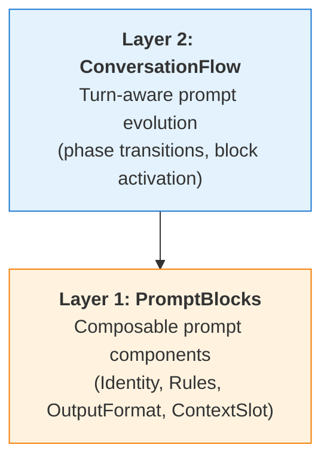

# Prompt Engineering Overview

Promptise provides a composable prompt engineering framework: compose prompts from reusable blocks, evolve them across conversation turns, and enhance them with strategies, guards, context injection, and inspection tools.

## Quick Example

```python
from promptise.prompts import prompt
from promptise.prompts.blocks import blocks, Identity, Rules, OutputFormat

@prompt(model="openai:gpt-5-mini")
@blocks(
    Identity("Senior data analyst", traits=["precise", "data-driven"]),
    Rules(["Cite specific numbers", "Include confidence levels"]),
    OutputFormat(format="markdown"),
)
async def analyze(text: str) -> str:
    """Analyze the following data and provide insights: {text}"""

result = await analyze("Q1 revenue: $2.3M, Q2: $2.8M, Q3: $3.1M")
```

!!! info "You need an API key first"
    Every model provider needs a credential. Put it in a `.env` file in your project (Promptise loads it automatically, in scripts and in the CLI) or pass it in code with `Model(...)`: explained in [**Models & Providers → In code: Model**](../core/agents/models.md#in-code-model): `Model("gpt-4o-mini", provider="openai", api_key="...")`. The **exact variable name for every provider** (Azure AI Foundry, Bedrock, Gemini, Ollama, …) is in [**Configuration & Secrets → Every provider's variables**](../getting-started/configuration.md#every-providers-variables); self-hosted and inference endpoints are in [**Models & Providers → Custom, self-hosted and inference endpoints**](../core/agents/models.md#custom-self-hosted-and-inference-endpoints). `promptise models env <provider>` prints the lines a provider needs and `promptise models check <model>` tells you what is still missing.

The `@prompt` decorator turns any async function into an LLM-backed prompt. The docstring becomes the template, and `{text}` is filled from the function argument. The `@blocks` decorator attaches composable prompt components that are assembled into the system prompt at execution time.

## The 2-Layer Architecture

Each layer is independent. Use one or both depending on the complexity of your use case.



| Layer | Module | Purpose |
|-------|--------|---------|
| **Layer 1** | `promptise.prompts.blocks` | Composable, priority-ranked prompt components |
| **Layer 2** | `promptise.prompts.flows` | Conversation state machine where the system prompt evolves across phases |

## The `@prompt` Decorator

The `@prompt` decorator is the core entry point. It wraps an async function into a `Prompt` object that can call an LLM directly or integrate with `build_agent()`.

```python
from promptise.prompts import prompt

@prompt(model="openai:gpt-5-mini")
async def summarize(text: str) -> str:
    """Summarize the following: {text}"""

# Standalone call
result = await summarize("Long article text here...")

# Agent integration -- the prompt is re-rendered on each invocation
from promptise import build_agent
from promptise.config import HTTPServerSpec

agent = await build_agent(
    model="openai:gpt-5-mini",
    servers={"tools": HTTPServerSpec(url="http://localhost:8080/mcp")},
    instructions=summarize,
)
```

**Dual-mode operation:**

- **Standalone**: `await my_prompt("input")` calls the LLM directly with the full pipeline: template, context, perspective, strategy, constraints, guards, LLM call, parse, output guards.
- **Agent-integrated**: `build_agent(instructions=my_prompt)` uses `render_async()` to build dynamic system prompts on every agent invocation. The prompt's [guards](guards.md) check each user message (input guards) and each reply (output guards), and its [inspector](inspector.md) records each render.

### Runtime Composition

`Prompt` objects support fluent composition methods that return new configured copies:

```python
from promptise.prompts.strategies import chain_of_thought, analyst

configured = (
    summarize
    .with_strategy(chain_of_thought)
    .with_perspective(analyst)
    .with_constraints("Under 500 words", "Include confidence scores")
)
result = await configured("quarterly earnings report...")
```

### Prompt Composition Methods

The `Prompt` object returned by `@prompt` supports a full set of fluent composition methods. Every method returns a **new copy** of the prompt, leaving the original unchanged.

**Model and component attachment:**

```python
from promptise.prompts.blocks import Identity, Rules
from promptise.prompts.guards import length, content_filter
from promptise.prompts.inspector import PromptInspector
from promptise.prompts.context import UserContext

# Override the model for a single call
fast = summarize.with_model("openai:gpt-5-mini")

# Attach blocks at runtime
with_blocks = summarize.with_blocks(
    Identity("Senior analyst"),
    Rules(["Be concise"]),
)

# Attach guards at runtime
guarded = summarize.with_guards(
    content_filter(blocked=["secret"]),
    length(max_length=2000),
)

# Attach an inspector for tracing
inspector = PromptInspector()
traced = summarize.with_inspector(inspector)

# Inject world context
contextualized = summarize.with_world(user=UserContext(name="Alice", expertise_level="expert"))
```

**Lifecycle hooks:**

Hooks receive the call's `PromptContext` (sync or async functions both work). `on_before(fn)` is called as `fn(ctx)`, `on_after(fn)` as `fn(ctx, result)` and `on_error(fn)` as `fn(ctx, exc)`; the error is re-raised after the hook returns. Each method replaces any hook set before.

```python
from promptise.prompts import prompt

@prompt(model="openai:gpt-5-mini")
async def summarize(text: str) -> str:
    """Summarize the following: {text}"""

async def log_before(ctx):
    print(f"[{ctx.prompt_name}] Starting with: {ctx.rendered_text[:80]}...")

async def log_after(ctx, output):
    print(f"[{ctx.prompt_name}] Completed, output length: {len(str(output))}")

async def handle_error(ctx, error):
    print(f"[{ctx.prompt_name}] Failed: {error!r}")

hooked = (
    summarize
    .on_before(log_before)
    .on_after(log_after)
    .on_error(handle_error)
)
result = await hooked("quarterly earnings report...")
```

**Introspection (no LLM call):**

```python
from promptise.prompts import prompt

@prompt(model="openai:gpt-5-mini")
async def summarize(text: str) -> str:
    """Summarize the following: {text}"""

# The full text that would be sent: blocks, template, context, perspective,
# strategy, constraints and schema instructions
text = await summarize.render_async(text="sample input")

# The same as LangChain messages ([SystemMessage]); pass a PromptContext with
# rendered_text set to also get a HumanMessage
messages = await summarize.to_messages(text="sample input")

# Synchronous render: skips context providers (they are async)
print(summarize.render(text="sample input"))

print(summarize.name)         # "summarize"
print(summarize.model)        # "openai:gpt-5-mini"
print(summarize.template)     # "Summarize the following: {text}"
print(summarize.return_type)  # <class 'str'>
```

| Method / attribute | Returns | Description |
|--------|---------|-------------|
| `with_model(model)` | `Prompt` | Override the LLM model |
| `with_blocks(*blocks)` | `Prompt` | Add composable prompt blocks |
| `with_context(*providers)` | `Prompt` | Add [context providers](context.md) |
| `with_guards(*guards)` | `Prompt` | Add guards (each runs on input and output) |
| `with_inspector(inspector)` | `Prompt` | Attach a `PromptInspector` for tracing |
| `with_world(**contexts)` | `Prompt` | Add named `BaseContext` objects to the world |
| `with_strategy(strategy)` | `Prompt` | Set the reasoning strategy |
| `with_perspective(perspective)` | `Prompt` | Set the cognitive perspective |
| `with_constraints(*texts)` | `Prompt` | Add constraint strings |
| `on_before(fn)` | `Prompt` | Set the pre-execution hook `fn(ctx)` |
| `on_after(fn)` | `Prompt` | Set the post-execution hook `fn(ctx, result)` |
| `on_error(fn)` | `Prompt` | Set the error hook `fn(ctx, exc)` |
| `render(ctx=None, **vars)` | `str` | Render without context providers (sync, no LLM call) |
| `await render_async(ctx=None, **vars)` | `str` | Render with context providers (no LLM call); records a trace when an inspector is attached |
| `await to_messages(ctx=None, **vars)` | `list` | `[SystemMessage]`, plus a `HumanMessage` when `ctx.rendered_text` is set |
| `name` | `str` | The function name (property) |
| `model` | `str` | The model string (property) |
| `template` | `str` | The cleaned docstring template (property) |
| `description` | `str \| None` | `@prompt(description=...)` or a YAML file's `description` (property) |
| `return_type` | `type \| None` | The return annotation (property) |
| `last_stats` | `PromptStats \| None` | Stats of the last standalone call |

### `@prompt` parameters

```text
prompt(
    model: str = "openai:gpt-5-mini",
    *,
    observe: bool | ObservabilityCollector | PromptObserver = False,
    inspect: PromptInspector | None = None,
    description: str | None = None,
) -> Callable[[Callable], Prompt]
```

| Parameter | Default | Description |
|-----------|---------|-------------|
| `model` | `"openai:gpt-5-mini"` | Model string passed to the chat model factory on each standalone call |
| `observe` | `False` | Record every standalone call as timeline events with a [`PromptObserver`](inspector.md#promptobserver). `True` records to the prompt's own collector (`my_prompt.observer.collector`); a collector or observer records there |
| `inspect` | `None` | A [`PromptInspector`](inspector.md) that records every call |
| `description` | `None` | What the prompt is for; shown to MCP clients when the prompt is served with `MCPServer.include_prompts()` |

### What a standalone call does

`await my_prompt(...)` binds the arguments to the function signature, then runs, in order:

1. Render the template with the arguments, build a `PromptContext`, run the `on_before` hook.
2. Assemble the blocks and put them before the template text.
3. Append each context provider's text.
4. Apply the perspective (prepended), then the strategy (appended instructions).
5. Append constraints as numbered "You MUST follow these requirements" lines, and JSON schema instructions when the return type is a Pydantic model, dataclass, `list` or `dict`.
6. Run the input guards on that full text, then send it to the model as one system message.
7. Strip the reasoning with the strategy's `parse()`, parse the reply into the return type, run the output guards, record `last_stats`, run `on_after`.

Return types: `str` (raw text), `int` and `float` (first number in the reply), `bool` (`true/yes/1`, `false/no/0`), `list` / `dict` / Pydantic models / dataclasses (the first JSON value in the reply, Markdown fences removed, then validated).

!!! warning "Template pitfalls"
    - The docstring is the template and is rendered with Python format syntax. Write literal braces as `{{` and `}}`, for example in a JSON example: `{{"key": "value"}}`.
    - Every `{name}` must be a function parameter (or have a default). A missing value raises `KeyError`.
    - Attribute and index access (`{user.name}`, `{items[0]}`) is rejected with `ValueError`.
    - Indentation is removed like `inspect.cleandoc`, so you can indent a multi-line docstring with your code.

## Strategies

Strategies control **how** the agent reasons. They wrap the prompt text with reasoning instructions before the LLM call, then parse the structured output afterward.

| Strategy | Reasoning Approach |
|----------|-------------------|
| `chain_of_thought` | Step-by-step breakdown with `---ANSWER---` marker |
| `structured_reasoning` | Customizable phases (Understand, Analyze, Evaluate, Conclude) |
| `self_critique` | Generate, critique for flaws, then produce improved answer |
| `plan_and_execute` | Create a numbered plan, execute each step, synthesize |
| `decompose` | Break into subproblems, solve independently, combine |

Strategies compose with the `+` operator:

```python
from promptise.prompts.strategies import chain_of_thought, self_critique

combined = chain_of_thought + self_critique
```

## Perspectives

Perspectives control **from where** the agent reasons. They are orthogonal to strategies: any perspective can pair with any strategy.

| Perspective | Framing |
|-------------|---------|
| `analyst` | Evidence-based, data patterns, measurable outcomes |
| `critic` | Challenge assumptions, identify weaknesses, stress-test |
| `advisor` | Balanced recommendations, trade-off analysis, actionable steps |
| `creative` | Unconventional solutions, novel combinations, innovation |

```python
from promptise.prompts.strategies import chain_of_thought, analyst

@prompt(model="openai:gpt-5-mini")
async def evaluate(proposal: str) -> str:
    """Evaluate this proposal: {proposal}"""

result = await evaluate.with_strategy(chain_of_thought).with_perspective(analyst)(
    "Expand into the European market next quarter"
)
```

## API Summary

| Component | Import | Purpose |
|-----------|--------|---------|
| `@prompt` | `promptise.prompts` | Core decorator for LLM-backed functions |
| `@blocks` | `promptise.prompts.blocks` | Attach composable prompt blocks |
| `@guard` | `promptise.prompts.guards` | Input/output validation |
| `@context` | `promptise.prompts.context` | Dynamic context injection |
| `ConversationFlow` | `promptise.prompts.flows` | Phase-based conversation state machine |
| `PromptBuilder` | `promptise.prompts.builder` | Fluent runtime prompt construction |
| `PromptSuite` | `promptise.prompts.suite` | Group related prompts with shared config |
| `PromptRegistry` | `promptise.prompts.registry` | Versioned prompt storage |
| `PromptInspector` | `promptise.prompts.inspector` | Assembly and execution tracing |

!!! tip "Choosing the right layer"
    - **Simple single-turn prompts**: Use `@prompt` with `@blocks` (Layer 1)
    - **Multi-turn conversations**: Add `ConversationFlow` (Layer 2)

## What's Next?

- [Layer 1: PromptBlocks](blocks.md): Build prompts from composable components
- [Layer 2: ConversationFlow](flows.md): Evolve prompts across conversation turns
- [Strategies](strategies.md): Prompt strategies and composition patterns
- [Guards & Validation](guards.md): Input validation and safety guards

!!! tip "Learn the concept"

    - [System Prompt Best Practices for AI Agents in Python](https://www.promptise.com/guides/view/ai-agent-system-prompt-best-practices): Build agent prompts from reusable blocks and test them like code.
    - [Prompts as Interfaces: Design Prompts Like API Contracts](https://www.promptise.com/guides/view/prompts-as-interfaces-not-commands): Design prompts like API contracts.
