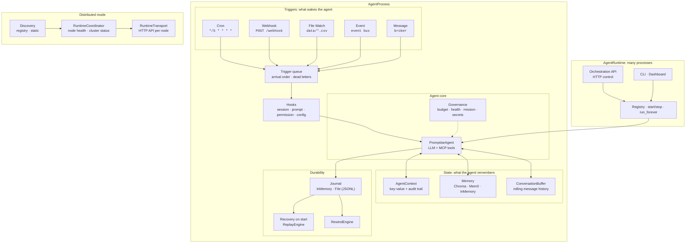

# Agent Runtime

LLMs are stateless by nature: they don't remember, they don't persist, and they can't react to the world on their own. The Agent Runtime is the **operating system for your AI agents**. It gives a stateless LLM what a real process needs: a lifecycle, scheduling, persistent state, crash recovery, limits, and control from code, HTTP or the command line.

```python
import asyncio

from promptise.runtime import AgentProcess, ProcessConfig, TriggerConfig


async def main():
    process = AgentProcess(
        name="data-watcher",
        config=ProcessConfig(
            model="openai:gpt-5-mini",
            instructions="You monitor data pipelines and alert on anomalies.",
            triggers=[TriggerConfig(type="cron", cron_expression="*/5 * * * *")],
            restart_policy="on_failure",
        ),
    )
    async with process:          # start(): CREATED -> STARTING -> RUNNING
        await asyncio.sleep(600) # the agent runs on every cron tick
    # close(): RUNNING -> STOPPING -> STOPPED


asyncio.run(main())
```

---

## Why you need it

A standard `build_agent()` call creates a request-response agent. You send a message, get a reply, and the agent is done. That works for chatbots and one-off tasks, but long-running agent systems need more:

- **Persistence**: agents that remember what they've seen, track metrics over time, and keep context across runs
- **Reactivity**: agents that wake up on schedules, respond to webhooks, watch files, or listen to events from other agents
- **Resilience**: agents that restore their state from a journal after a crash, keep events they couldn't process as dead letters, and restart automatically after failures
- **Control**: limits on cost and behavior, hooks at every lifecycle point, and an API and CLI to inspect, pause, rewind and restart running agents
- **Scale**: many agents in one runtime, and runtimes on several machines in one cluster

The Agent Runtime adds all of this on top of the same agent you already know how to build.

---

## Core concepts

### Agent processes

An [**AgentProcess**](processes.md) wraps a `PromptiseAgent` in a managed lifecycle. It builds the agent, connects MCP servers, starts triggers, and runs the agent once per trigger event. Each process follows a fixed [state machine](lifecycle.md) (created, starting, running, suspended, stopping, stopped, failed), and every transition is validated, recorded and emitted as a `process.*` event. A failed process can restart itself with backoff (`restart_policy`).

### Triggers

[Triggers](triggers/index.md) are how agents wake up. Instead of calling `agent.ainvoke()` yourself, you configure triggers that fire on their own:

- **Cron**: every 5 minutes, hourly, weekdays at 9:00 in a time zone, or any cron expression
- **Webhook**: HTTP requests from CI/CD systems, monitoring tools or external APIs, with signature checks
- **File Watch**: new, changed, deleted or moved files
- **Event**: events on an event bus you provide
- **Message**: messages on topics of a message broker you provide

A process can have several triggers. Events go into one queue per process and run in arrival order.

### Context and state

Every process has an [**AgentContext**](context.md) that persists across runs: a key-value store with an audit trail that records who changed what and when. The context is injected into every run, so the agent always sees its accumulated state. Context also manages long-term memory (ChromaDB, Mem0 or in-memory), environment variables and file mounts. Short-term memory is a rolling [**ConversationBuffer**](conversation.md).

### Journals, recovery and rewind

The [journal](journal/index.md) records state transitions, run results, context updates and checkpoints in a durable log. When a process starts, it restores its context state, conversation history, mission and budget counters from the last checkpoint of the same process name, so a crash or redeploy continues where the last run stopped. The [rewind engine](journal/rewind.md) rolls a process's state or conversation back to an earlier journal entry without deleting history.

### Governance

Autonomous agents need guardrails. Four governance subsystems are opt-in:

- **[Autonomy Budget](governance/budget.md)**: per-run and daily limits on tool calls, LLM turns, cost (abstract units) and irreversible actions. Enforcement can pause, stop or escalate. Counters survive restarts.
- **[Behavioral Health](governance/health.md)**: detects bad patterns without calling an LLM: stuck agents (the same call 3+ times), repeating loops (A→B→A→B), empty responses and high error rates. Logs, pauses, escalates or stops.
- **[Mission Model](governance/mission.md)**: an objective and success criteria. Every N runs an LLM judge (or your own check) evaluates progress.
- **[Secret Scoping](governance/secrets.md)**: per-process secrets, encrypted in memory, with TTLs, rotation without restart and access logging. Secret values are redacted from the journal, hooks and status output.

All four are off by default and cost nothing while off. Turn them on one at a time as an agent moves from prototype to production.

### Lifecycle hooks

[Hooks](hooks.md) run your code (an async Python function or an external command) at lifecycle points: session start and end, before a prompt goes to the model, on approval requests and denials, on configuration changes, when a process is spawned, and more. Some events can be blocked, so a hook can refuse a prompt, a tool approval or an agent's self-modification.

### Runtime manager

An [**AgentRuntime**](runtime-manager.md) runs many processes together: register them from code, a `RuntimeConfig` or [`.agent` manifests](manifests.md), start and stop them together, share one event notifier and hooks, and shut down cleanly on `SIGTERM` with `run_forever()`. One process failing doesn't affect the others.

### Control: API, CLI and dashboard

The [Orchestration API](api.md) manages a running runtime over HTTP: deploy, start, stop, suspend, resume and restart processes, change instructions, budgets and triggers live, send messages, read the journal and rewind. The [CLI](cli.md) wraps it: `promptise runtime start` (with `--detach`), `status`, `stop`, `restart`, `logs`, `rewind`, `validate` and `init`. The [dashboard](dashboard.md) is a live terminal UI.

### Distributed mode

With `DistributedConfig(enabled=True)`, each runtime runs a management transport, and one runtime can host a [coordinator](distributed/coordinator.md) that tracks the cluster's nodes (by registration or a static list) with health checks. One cluster token authenticates every request between nodes. See [Discovery & Transport](distributed/discovery-transport.md).

---

## The full picture

Here's what runs inside one `AgentProcess`, and around it:



### What each layer gives you

| Layer | Components | What it unlocks |
|-------|-----------|-----------------|
| **Triggers** | Cron, Webhook, File Watch, Event, Message | Agents that wake up on their own: no manual `ainvoke()` calls |
| **State** | AgentContext, MemoryProvider, ConversationBuffer | Agents that remember across runs: accumulated metrics, customer history, conversation continuity |
| **Durability** | Journal (InMemory/File), recovery on start, rewind, dead letters, restart policies | Agents that survive crashes: restore state from the last checkpoint, redeliver undelivered events, roll back a bad run, restart automatically |
| **Governance** | Budget, Health, Mission, Secrets | Agents with limits: capped cost, caught loops, judged progress, scoped credentials |
| **Hooks** | HookManager, ShellHook | Your policy at every lifecycle point: audit, transform or refuse |
| **Runtime** | AgentRuntime, Orchestration API, CLI, Dashboard | Many agents in one service: managed from code, HTTP or a terminal, shut down cleanly on SIGTERM |
| **Distributed** | ClusterNode, RuntimeCoordinator, RuntimeTransport, Discovery | Runtimes on several machines: authenticated HTTP API per node, health checks, cluster membership, remote start/stop for failover you script |
| **Self-modification** | Open mode, 14 meta-tools | Agents that change themselves: instructions, tools, servers, triggers and spawned processes, within limits |

---

## What Can You Build?

The runtime isn't limited to one pattern. Combine triggers, state, communication, and recovery to build systems that would otherwise require custom infrastructure:

### Autonomous operations

| System | Triggers | State | Communication | How it works |
|--------|----------|-------|---------------|--------------|
| **Pipeline monitor** | Cron (every 5 min) | Context stores metrics history | EventBus alerts | Agent checks data pipeline health on schedule, compares against stored baselines, fires `pipeline.degraded` events when anomalies appear |
| **Infrastructure watchdog** | Cron + Webhook | Context tracks uptime, incident count | MessageBroker escalation | Scheduled health checks + receives PagerDuty webhooks, correlates incidents over time, escalates through message topics |
| **Cost optimizer** | Cron (daily) | Memory stores spending trends | EventBus recommendations | Analyzes cloud spend daily, remembers historical patterns via ChromaDB, publishes optimization suggestions that other agents can act on |

### Reactive systems

| System | Triggers | State | Communication | How it works |
|--------|----------|-------|---------------|--------------|
| **Data quality gate** | File Watch (`data/*.csv`) | Context stores validation history | MessageBroker publishes results | Reacts to new data files, validates schema and quality, publishes pass/fail results to a topic that downstream ETL agents consume |
| **CI/CD assistant** | Webhook (GitHub) | Context tracks deployment history | EventBus notifies team agents | Receives deployment webhooks, runs checks via MCP tools, posts results back to GitHub, fires events for rollback agents |
| **Document processor** | File Watch (`uploads/`) | Memory stores extracted entities | MessageBroker routes to specialists | Watches for uploaded documents, extracts structured data, stores in memory, routes to domain-specific agents for further processing |

### Multi-agent coordination

| System | Triggers | State | Communication | How it works |
|--------|----------|-------|---------------|--------------|
| **Incident response team** | Event (monitor fires alerts) | Each agent has own context | EventBus (broadcast) + MessageBroker (directed) | 3 agents: monitor detects → analyst diagnoses root cause → responder executes fixes. Each maintains its own state, coordinates through events |
| **Customer support escalation** | Message (support queue topic) | Memory tracks customer history | MessageBroker routes by tier | Tier-1 agent handles common questions, escalates to Tier-2 for complex issues, Tier-3 for engineering. Memory persists customer context across agents |
| **Research pipeline** | Event (new task assigned) | Context tracks research progress | EventBus (progress updates) | Searcher → Analyzer → Writer → Reviewer chain, each triggered by the previous agent's completion event, sharing findings through context |

### Self-evolving agents (open mode)

With `execution_mode="open"`, agents get up to 14 [meta-tools](meta-tools.md) for self-modification (11 core, plus 3 governance tools when those subsystems are on):

| Meta-tool | What it does |
|-----------|-------------|
| `modify_instructions` | Agent rewrites its own system prompt based on experience |
| `create_tool` | Agent creates new Python tools at runtime |
| `connect_mcp_server` | Agent connects to new HTTP MCP servers |
| `add_trigger` / `remove_trigger` | Agent adjusts its own wake-up schedule |
| `spawn_process` / `list_processes` | Agent creates and monitors helper processes (which inherit its limits and can't spawn) |
| `store_memory` / `search_memory` / `forget_memory` | Agent manages its own long-term memory |
| `list_capabilities` | Agent inspects its current tools and triggers |
| `get_secret` | Agent reads scoped secrets (when secrets are enabled) |
| `check_budget` | Agent checks its remaining budget (when the budget is enabled) |
| `check_mission` | Agent checks mission progress (when a mission is enabled) |

Every change goes through the process's limits (`OpenModeConfig`) and the `config_change` hook, and `rollback()` undoes the agent's changes. This enables agents that adapt over time: an ops agent that learns new runbooks, a support agent that creates shortcuts for common issues, or a research agent that refines its own method.

---

## Quick examples

A single agent: see the example at the top of this page.

!!! info "You need an API key first"
    Every model provider needs a credential. Put it in a `.env` file in your project (Promptise loads it automatically, in scripts and in the CLI), or pass it in code with `Model(...)`, explained in [**Models & Providers → In code: Model**](../core/agents/models.md#in-code-model): `Model("gpt-5-mini", provider="openai", api_key="...")`. The **exact variable name for every provider** (Azure AI Foundry, Bedrock, Gemini, Ollama, …) is in [**Configuration & Secrets → Every provider's variables**](../getting-started/configuration.md#every-providers-variables); self-hosted and inference endpoints are in [**Models & Providers → Custom, self-hosted and inference endpoints**](../core/agents/models.md#custom-self-hosted-and-inference-endpoints). `promptise models env <provider>` prints the lines a provider needs and `promptise models check <model>` tells you what is still missing.

Several agents in one runtime, run as a service:

```python
import asyncio

from promptise.runtime import AgentRuntime, ProcessConfig, RuntimeConfig, TriggerConfig


async def main():
    runtime = AgentRuntime(RuntimeConfig(processes={
        "monitor": ProcessConfig(
            model="openai:gpt-5-mini",
            instructions="Check pipeline metrics and report anomalies.",
            triggers=[TriggerConfig(type="cron", cron_expression="*/5 * * * *")],
        ),
    }))
    await runtime.load_directory("agents/")  # plus every agents/*.agent manifest
    await runtime.run_forever()              # stops cleanly on SIGTERM / Ctrl+C


asyncio.run(main())
```

An agent declared in a manifest:

```yaml title="agents/analyzer.agent"
version: "1.0"
name: pipeline-analyzer
model: openai:gpt-5-mini
instructions: |
  You analyze pipeline alerts and find the root cause.
triggers:
  - type: webhook
    webhook_path: /alerts
    webhook_port: 9091
journal:
  level: full
config:
  restart_policy: on_failure
  max_restarts: 3
```

```bash
promptise runtime validate agents/
promptise runtime start agents/ --detach
promptise runtime status
```

---

## How it all fits together

```
Layer 4: Distributed mode       Cluster nodes, coordinator, discovery, authenticated transport
         │
Layer 3: AgentRuntime           Many processes, Orchestration API, CLI, dashboard
         │
Layer 2: AgentProcess           Lifecycle, triggers, context, journal, recovery, governance, hooks
         │
Layer 1: build_agent()          Stateless LLM agent with MCP tool access
```

Each layer is optional. Use Layer 1 alone for simple chatbots, add Layer 2 for autonomous agents, Layer 3 for multi-agent services, and Layer 4 for deployments across machines.

---

## Runtime errors

Every runtime exception derives from `RuntimeBaseError` (itself a `RuntimeError`), so
`except RuntimeBaseError` catches all of them. Import them from `promptise.runtime`:

| Exception | Raised when |
|---|---|
| `ProcessStateError` | A lifecycle transition is not allowed, for example `resume()` on a process that is not suspended |
| `ManifestError` | An `.agent` manifest cannot be read or parsed |
| `ManifestValidationError` | A manifest does not match the schema (a `ManifestError`) |
| `ManifestEnvVarError` | A `${VAR}` in a manifest names an unset variable (a `ManifestError`) |
| `JournalError` | A journal read, write or replay fails |
| `TriggerError` | A trigger fails to start, stop or produce events |
| `BudgetExceededError` | A tool call would exceed an autonomy budget limit |

`OrchestrationAPIError` is separate: it is an `httpx.HTTPStatusError` that
`OrchestrationClient` raises for an error response, with `status_code`, `code`,
`error_message` and `error_id` (see [Orchestration API](api.md)).

---

## What's next

**Learn the concepts in depth:**

- [Agent Processes](processes.md): lifecycle methods, recovery, dead letters and restart policies
- [Process Lifecycle](lifecycle.md): states, transitions and `process.*` events
- [Runtime Manager](runtime-manager.md): many processes with `AgentRuntime` and `run_forever()`
- [Configuration](configuration.md): every config class and field
- [Agent Manifests](manifests.md): the declarative `.agent` YAML format
- [Context & State](context.md): persistent state, memory and environment
- [Triggers](triggers/index.md): all five trigger types
- [Journal](journal/index.md): journals, recovery and rewind
- [Runtime Hooks](hooks.md): code at every lifecycle point
- [Meta-Tools](meta-tools.md): open mode and its limits
- [Orchestration API](api.md) and [CLI Commands](cli.md): control a running runtime
- [Distributed](distributed/coordinator.md): multi-node coordination

**Build something real:**

- [Building Agentic Runtime Systems](../guides/agentic-runtime.md): step-by-step guide from a single agent to a distributed deployment

!!! tip "Learn the concept"

    - [Autonomous AI Agent Runtime: Budgets, Crash Recovery, API](https://www.promptise.com/guides/view/autonomous-ai-agent-runtime): What an agent runtime adds: budgets, restarts and crash recovery.
    - [Run Multiple AI Agents: One Runtime, Many Processes](https://www.promptise.com/guides/view/run-multiple-ai-agents): One runtime, many processes, and a clean shutdown on SIGTERM.
    - [Durable AI Agents: Crash Recovery and Safe Resume](https://www.promptise.com/guides/view/durable-ai-agent-crash-recovery): Journal a process and continue where it stopped after a crash.
    - [Topic hub: Runtime, triggers and deployment](https://www.promptise.com/guides/topics/runtime-deployment): Every guide on triggers, durable runs and deployment.
