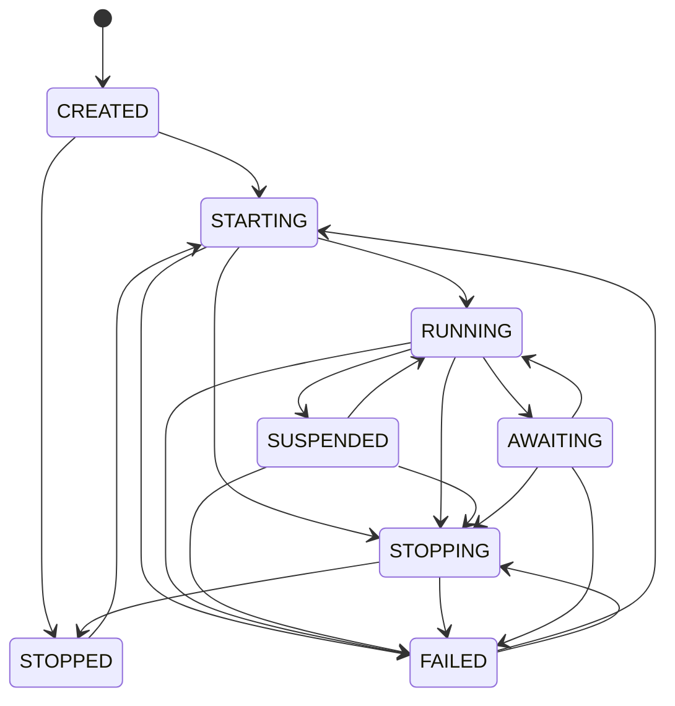

# Process Lifecycle

Every `AgentProcess` moves through a fixed set of states: created, starting, running, suspended, stopping, stopped and failed. The `ProcessLifecycle` state machine checks every transition against a transition map, rejects invalid ones with a `StateError`, and records each change with a timestamp and a reason. Use this page to know what a state means, what moves a process between states, and which event each change emits.

```python
import asyncio

from promptise import CallbackSink, EventNotifier
from promptise.runtime import AgentProcess, ProcessConfig


def on_event(event):
    if event.event_type.startswith("process."):
        print(event.event_type, event.data.get("reason", ""))


async def main():
    notifier = EventNotifier(sinks=[CallbackSink(on_event)])
    process = AgentProcess(
        "watcher",
        ProcessConfig(model="openai:gpt-5-mini"),
        event_notifier=notifier,
    )
    await process.start()    # CREATED -> STARTING -> RUNNING
    await process.suspend()  # RUNNING -> SUSPENDED
    await process.resume()   # SUSPENDED -> RUNNING
    await process.stop()     # RUNNING -> STOPPING -> STOPPED
    print([t.to_state.value for t in process.lifecycle.history])


asyncio.run(main())
```

```text
process.started
process.suspended manual
process.resumed manual
process.stopped
['starting', 'running', 'suspended', 'running', 'stopping', 'stopped']
```

---

## State diagram

The diagram shows every transition in `VALID_TRANSITIONS` (`promptise.runtime.lifecycle`) and nothing else. `AWAITING` is reserved: it is in the map, but `AgentProcess` never enters it.



---

## Valid transitions

| From | Allowed targets |
|---|---|
| `CREATED` | `STARTING`, `STOPPED` |
| `STARTING` | `RUNNING`, `STOPPING`, `FAILED` |
| `RUNNING` | `SUSPENDED`, `STOPPING`, `FAILED`, `AWAITING` |
| `SUSPENDED` | `RUNNING`, `STOPPING`, `FAILED` |
| `STOPPING` | `STOPPED`, `FAILED` |
| `STOPPED` | `STARTING` |
| `FAILED` | `STARTING`, `STOPPING` |
| `AWAITING` (reserved) | `RUNNING`, `STOPPING`, `FAILED` |

Any other transition raises `StateError`. A transition to the current state is invalid too: calling `suspend()` on a suspended process raises.

---

## What each state means

| State | Value | Meaning |
|---|---|---|
| `CREATED` | `"created"` | Constructed, never started. `stop()` moves it straight to `STOPPED` without an event. |
| `STARTING` | `"starting"` | `start()` is running: journal recovery (first start only), secrets, agent build and MCP connections, triggers, workers and heartbeat. Trigger events that arrive wait until the process is `RUNNING`. |
| `RUNNING` | `"running"` | Processing trigger events. An idle process with nothing to do is still `RUNNING`. |
| `SUSPENDED` | `"suspended"` | Paused. Triggers keep firing and their events queue in arrival order; a run in flight finishes. See [Why a process is suspended](#why-a-process-is-suspended). |
| `STOPPING` | `"stopping"` | Teardown in progress: workers cancelled, triggers stopped, queued events dead-lettered, agent and MCP clients closed. |
| `STOPPED` | `"stopped"` | Stopped cleanly. `start()` can start it again; context state, long-term memory and conversation history are kept. |
| `FAILED` | `"failed"` | `max_consecutive_failures` events in a row failed, or `start()` raised. New trigger events are dead-lettered (`"process failed"`) and a webhook answers 503. `start()` (or an automatic restart) goes to `STARTING`; `stop()` goes to `STOPPING`, then `STOPPED`. |
| `AWAITING` | `"awaiting"` | Reserved. The value and its transitions are kept for backward compatibility; `AgentProcess` never enters it. |

### Why a process is suspended

`SUSPENDED` has several causes. `process.suspend_reason` (and `status()["suspend_reason"]`) says which one; it is `None` when the process is not suspended.

| `suspend_reason` | Who suspends | How it resumes |
|---|---|---|
| `"manual"` | `process.suspend()` (default reason), the [control API](api.md), the [dashboard](dashboard.md) | `process.resume()` |
| `"idle"` | `idle_timeout` seconds without a run, with nothing queued or running (checked every `heartbeat_interval`) | By itself, when the next trigger event arrives or you call `inject()` (the `process.resumed` reason is `"trigger"`) |
| `"budget"` | [Autonomy budget](governance/budget.md) with `on_exceeded="pause"` or `"escalate"` | `process.resume()` |
| `"health"` | [Behavioral health](governance/health.md) with `on_anomaly="pause"` or `"escalate"` | `process.resume()` |
| `"rewind"` | `process.rewind()` on a running process, for the duration of the rewind | By itself, when the rewind ends |

`resume()` restarts the idle clock, so `idle_timeout` counts from the resume, and the queued events run in the order they arrived.

---

## What moves a process

| Transition | Caused by | Event |
|---|---|---|
| `CREATED → STARTING` | `start()` | -- |
| `CREATED → STOPPED` | `stop()` before `start()` | none |
| `STARTING → RUNNING` | Startup complete | `process.started` |
| `STARTING → FAILED` | Startup raised (bad MCP server, missing secret, ...). `start()` re-raises the error; your own `start()` is not retried | `process.failed` |
| `STARTING → STOPPING` | Allowed by the map. `stop()` called during `start()` waits for `start()` to finish first | -- |
| `RUNNING → SUSPENDED` | `suspend()`, `idle_timeout`, budget, health, rewind | `process.suspended` |
| `RUNNING → STOPPING` | `stop()`, `max_lifetime`, budget `on_exceeded="stop"`, health `on_anomaly="stop"`, mission completion | -- |
| `RUNNING → FAILED` | `max_consecutive_failures` reached | `process.failed` |
| `SUSPENDED → RUNNING` | `resume()`, or a trigger event for an idle-suspended process | `process.resumed` |
| `SUSPENDED → STOPPING` | `stop()` | -- |
| `SUSPENDED → FAILED` | A run that was in flight when the process was suspended fails and reaches `max_consecutive_failures` | `process.failed` |
| `STOPPING → STOPPED` | Teardown complete | `process.stopped` (not during a `max_lifetime` recycle) |
| `STOPPED → STARTING` | `start()`, `AgentRuntime.restart_process()`, a `max_lifetime` recycle | -- |
| `FAILED → STARTING` | `start()`, `restart_process()`, `start_all()`, an automatic restart | `process.restarted` (automatic restart only, before the attempt) |
| `FAILED → STOPPING` | `stop()` | -- |

`STOPPING → FAILED` and the `AWAITING` transitions are allowed by the map but not used by `AgentProcess`.

Restarting a `FAILED` process (by `start()` or an automatic restart) first tears down what the failed run left: trigger listeners, triggers, heartbeat and agent. Nothing fires twice. See [Restart policies](processes.md#restart-policies) for backoff and limits.

---

## Lifecycle events

With an `event_notifier`, the process emits these events. Every event's `data` holds `process_name` and `process_id` plus the keys below; `agent_id` is the process name, and `metadata` holds `process_name`, `process_id` and `model` (when the model is a string).

| Event | Severity | When | Extra `data` keys |
|---|---|---|---|
| `process.started` | `info` | Entered `RUNNING` (every start, automatic restarts included) | -- |
| `process.stopped` | `info` | A stop finished (not for `CREATED → STOPPED`) | -- |
| `process.failed` | `critical` | Entered `FAILED` | `reason`, `error` (the real error, `"Type: message"`, at most 500 characters) |
| `process.restarted` | `warning` | An automatic restart attempt begins (after its backoff), or a `max_lifetime` recycle | `reason`, `attempt` (`None` for a recycle), `max_restarts` |
| `process.restart_exhausted` | `critical` | A failure with `max_restarts` already used up; the process stays `FAILED` | `reason`, `restarts`, `max_restarts`, `error` |
| `process.suspended` | `warning` | Entered `SUSPENDED` | `reason` (`"manual"`, `"idle"`, `"budget"`, `"health"`, `"rewind"`) |
| `process.resumed` | `info` | Left `SUSPENDED` | `reason` (`"manual"`, `"trigger"`, `"rewind"`), `suspended_for` (the suspension's reason) |
| `process.rewound` | `warning` | `rewind()` applied | `target_entry_id`, `mode`, `actor`, `entries_affected` |

A failed process that gets restarted and fails again emits `process.failed` each time, and `process.restart_exhausted` once the limit is hit:

```text
process.started
process.failed             error="GraphExecutionError: ... RuntimeError: model down"
process.restarted          attempt=1, max_restarts=1
process.started
process.failed             error="GraphExecutionError: ... RuntimeError: model down"
process.restart_exhausted  restarts=1, max_restarts=1
```

The same process also emits `invocation.*` events from its agent and, when enabled, `budget.*`, `health.*` and `mission.*` events (see the [governance](governance/budget.md) pages). Journal entries mirror the lifecycle: a `state_transition` entry per transition (`from_state`, `to_state`, `reason`, `process_id`), plus `restart`, `restart_exhausted` and `recovered` entries.

The [lifecycle hooks](hooks.md) `session_start` (on entering `RUNNING`) and `session_end` (before a stop or restart) follow the same lifecycle.

---

## StateError and ProcessStateError

`StateError` is the one exception for an invalid transition. It subclasses `ProcessStateError` (which subclasses `RuntimeBaseError`) and `ValueError`, so any of these catches it:

```python
from promptise.runtime import ProcessStateError, RuntimeBaseError, StateError

try:
    await process.start()  # already running
except ProcessStateError as exc:  # or StateError, ValueError, RuntimeBaseError
    print(exc)
    # Process 'watcher': Cannot transition from 'running' to 'starting'.
    # Allowed targets: ['awaiting', 'failed', 'stopping', 'suspended']
```

| Attribute | Type | Value |
|---|---|---|
| `current` | `ProcessState` | The state the transition started from |
| `target` | `ProcessState` | The rejected target |
| `process_id` | `str \| None` | The process name (an `AgentProcess` always sets it) |
| `current_state` | `str` | `current.value` |
| `attempted_state` | `str` | `target.value` |

The message starts with `Process '<name>': ` when the process is known and lists the allowed targets (sorted by value). The runtime never raises a bare `ProcessStateError`; it exists as the base class.

Which `AgentProcess` methods raise it:

| Call | Raises when |
|---|---|
| `start()` | The process is `STARTING`, `RUNNING` or `SUSPENDED` (already started) |
| `suspend()` | The process is not `RUNNING` |
| `resume()` | The process is not `SUSPENDED` |
| `stop()` | Never for a state reason: stopping a `STOPPED` or `STOPPING` process does nothing |

---

## Using ProcessLifecycle directly

`AgentProcess` owns its `ProcessLifecycle` (`process.lifecycle`). You can use the class on its own, for example in tests:

```python
from promptise.runtime import ProcessLifecycle, ProcessState, StateError

lc = ProcessLifecycle(process_id="demo")  # starts in CREATED
await lc.transition(ProcessState.STARTING, reason="CLI start command")
await lc.transition(ProcessState.RUNNING, reason="agent built")

if lc.can_transition(ProcessState.SUSPENDED):
    await lc.transition(ProcessState.SUSPENDED, reason="idle", metadata={"idle_s": 300})

try:
    await lc.transition(ProcessState.CREATED)
except StateError as exc:
    print(exc.current, exc.target)  # ProcessState.SUSPENDED ProcessState.CREATED
```

### Listeners

`add_listener(callback)` registers a sync or async callable that receives the `ProcessTransition` after every successful transition. Listeners run in registration order, after the state has changed and outside the lock, so they may read `lc.state` or start another transition. A listener that raises is logged and skipped; it never undoes the transition.

```python
lc.add_listener(lambda t: print(f"{t.from_state.value} -> {t.to_state.value}: {t.reason}"))
```

### ProcessTransition

| Field | Type | Description |
|---|---|---|
| `from_state` | `ProcessState` | Previous state |
| `to_state` | `ProcessState` | New state |
| `timestamp` | `datetime` | When the transition happened (UTC) |
| `reason` | `str` | Human-readable explanation |
| `metadata` | `dict[str, Any]` | Extra context; `AgentProcess` puts the error under `"error"` for `FAILED` |

`to_dict()` and `ProcessTransition.from_dict(data)` convert to and from JSON-compatible dicts.

### History and snapshots

```python
for t in lc.history:  # a copy, oldest first
    print(t.from_state.value, "->", t.to_state.value, t.reason)

snapshot = lc.snapshot()  # {"state": "suspended", "history": [...]}
restored = ProcessLifecycle.from_snapshot(snapshot)
assert restored.state == lc.state
```

`from_snapshot()` restores the state and history only; listeners and the `process_id` are not part of a snapshot.

### API summary

| Method / property | Description |
|---|---|
| `ProcessLifecycle(initial=ProcessState.CREATED, *, process_id=None)` | Create a state machine |
| `state` | Current `ProcessState` |
| `history` | Copy of all `ProcessTransition` records |
| `can_transition(target)` | Whether `target` is allowed from the current state |
| `await transition(target, *, reason="", metadata=None)` | Perform a transition; returns the `ProcessTransition`, raises `StateError` |
| `add_listener(callback)` | Call `callback(transition)` after every transition |
| `snapshot()` | `{"state": ..., "history": [...]}` |
| `ProcessLifecycle.from_snapshot(data)` | Rebuild from a snapshot |

---

## Concurrency

Transitions are serialized with an `asyncio.Lock`. That makes `ProcessLifecycle` safe for concurrent tasks of one event loop; it is not thread-safe, so call it (and `AgentProcess`) from the loop that runs the process.

Serialized does not mean "only one wins". Concurrent transitions run one after another, and each is checked against the state the previous one left:

```python
lc = ProcessLifecycle(initial=ProcessState.RUNNING)
await asyncio.gather(
    lc.transition(ProcessState.SUSPENDED),  # RUNNING -> SUSPENDED
    lc.transition(ProcessState.STOPPING),   # SUSPENDED -> STOPPING, also valid
)
assert lc.state == ProcessState.STOPPING
```

A transition that is no longer valid when its turn comes raises `StateError`.

---

## Common pitfalls

- **Waiting for `AWAITING`.** It never happens. An idle process is `RUNNING`, or `SUSPENDED` with `suspend_reason == "idle"` after `idle_timeout`.
- **Treating every `SUSPENDED` the same.** Only an idle suspension resumes by itself. A budget, health or manual suspension waits for `resume()`; its trigger events keep queueing (the queue holds 1000 events) and webhooks keep answering 202.
- **Treating `FAILED` as final.** With `restart_policy="on_failure"` or `"always"` a failed process is restarted with backoff. Alert on `process.restart_exhausted` (it gave up), not only on `process.failed`.
- **Expecting `process.stopped` from a never-started process.** `stop()` on a `CREATED` process moves it to `STOPPED` without an event.
- **Calling `start()` on a running process.** It raises `StateError`. Use `AgentRuntime.restart_process()` to stop and start in one call.
- **Driving a process from another thread.** The lifecycle lock is an `asyncio.Lock`; use `asyncio.run_coroutine_threadsafe()` to reach the process's loop.

---

## What's next

- [Agent Processes](processes.md) -- `start()`, `stop()`, `suspend()`, `resume()`, restart policies and dead letters
- [Runtime Manager](runtime-manager.md) -- how `AgentRuntime` starts, restarts and stops many processes
- [Runtime Hooks](hooks.md) -- run code on `session_start`, `session_end` and other lifecycle points
- [Journal](journal/index.md) -- durable record of every transition, and recovery on start

!!! tip "Learn the concept"

    - [Pause and Resume an AI Agent: Lifecycle States Explained](https://www.promptise.com/guides/view/ai-agent-pause-resume) -- The lifecycle states, suspend and resume, and what happens to queued work.
    - [AI Agent Auto-Restart: Restart Policies and Timeouts](https://www.promptise.com/guides/view/ai-agent-auto-restart) -- Restart policies, backoff, restart limits and an alert when the runtime gives up.
    - [Durable AI Agents: Crash Recovery and Safe Resume](https://www.promptise.com/guides/view/durable-ai-agent-crash-recovery) -- Journal a process and continue where it stopped after a crash.
